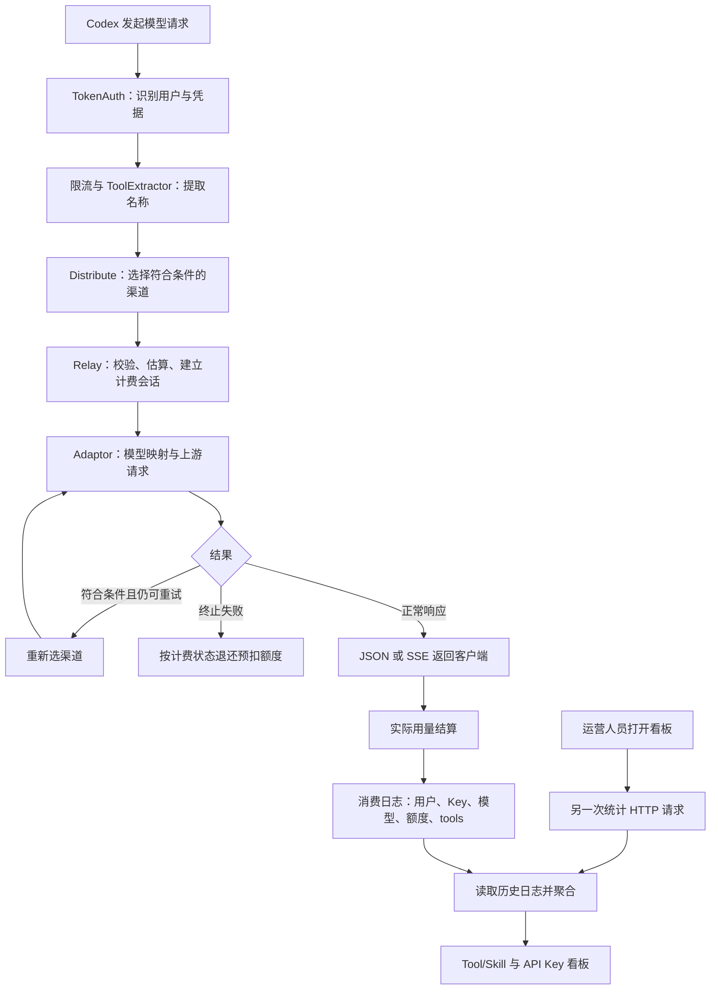

# 计费与运营平台：面试讲述与追问准备

核对日期：2026-09-17。依据当前工作区源码、局部 Git 历史及仓库已有实验报告。源码基线 HEAD 为 `ff6554ee8`，工作区另有未提交改动；本稿不是线上版本核验。

初稿只做源码分析与文档整理。2026-09-17后续深入选路时，运行并通过了 `setting/operation_setting` 的重试/禁用状态码定向测试，命令与边界见第6节；没有调用真实模型、查询生产账单或重新压测。下面的示例用户、渠道、额度都是教学假设。阅读完成不代表学习者已确认掌握。

## 1. 先明确你在讲哪件事

这段经历的主线是：让 Codex 等客户端通过现有大模型中转平台调用模型，平台负责选择上游渠道、处理失败、按用量结算，再把调用记录转成可查询的运营数据。

业务上要回答四个问题：

| 业务问题 | 平台解决方法 | 对应模块 |
| --- | --- | --- |
| 谁可以调用、费用归谁 | API Token / OAuth 鉴权，关联本地用户 | `middleware/auth.go` |
| 请求发往哪里，一个上游异常怎么办 | 模型与分组筛选、优先级、加权随机、有限重试 | `middleware/distributor.go`、`model/channel_cache.go`、`controller/relay.go` |
| 消耗了多少额度 | 估算、预扣、实际用量结算、失败退款 | `service/billing_session.go`、`service/text_quota.go` |
| 谁用了哪些工具、哪个 Key 消耗较高 | 提取元数据、写消费日志、聚合查询、看板 | `middleware/tool_extractor.go`、`model/log.go`、前端统计组件 |

这些是同一个 Go/Gin 后端中的模块。`service/` 目录不是独立部署的微服务。关系数据库保存业务和日志数据，Redis用于部分缓存、限流等辅助能力；渠道选择中的内存缓存也不能直接称为 Redis 调度。

**贡献边界：**优先级、加权随机、重试、供应商适配和基础计费是 new-api 已有能力。下游提交能证明新增了 Tool/Skill 采集、统计接口、看板、API Key 统计展示及 OAuth 钱包归属适配。Git 能证明仓库发生过这些改动，不能独自证明每项都由你个人完成；第一人称表述只保留实际负责的工作。

## 2. 面试开场可以这样讲

> 我参与的是基于 new-api 的内部大模型中转平台。Codex 等客户端通过统一入口调用模型，平台统一处理用户鉴权、渠道选择、用量计费和调用日志。
>
> 这部分工作主要围绕调用稳定性和运营可观测性展开。渠道侧扩展多个上游接入，复用并配置平台已有的优先级分层、同层加权随机和错误分类重试机制，让正常流量在主渠道间分配，符合条件的失败请求可以转到备用渠道。
>
> 统计侧补充了 Tool/Skill 和 API Key 两类看板。Tool/Skill 的做法是在请求入口提取工具和技能名称，随消费日志保存，再增加全局和个人两个范围的汇总、明细接口；API Key 看板则基于消费日志按用户和 Key 聚合调用量、Token 与额度。
>
> 这样运营人员能按用户、Key、模型和工具关联记录查看使用情况，并结合请求日志排查异常。这里的工具统计是请求关联口径，计费仍然依据模型用量和配置价格完成。

如果 OAuth 钱包适配确实是你负责的，可以补充：

> Codex 接入还涉及两类凭据的计费归属。我区分了 OAuth access token 和普通 API Token，避免不同表的数字 ID 碰撞导致误读、误扣其他 Key，并让 OAuth 账单展示回到认证用户的钱包。

### 2.1 从单渠道扩展到多渠道的具体口述

按用户提出的业务场景组织故事；以下渠道参数、错误和请求次数是讲解例子，不是本轮核实的生产配置或故障记录。2026-09-17进一步确认：用户询问的是公司内部部署，但尚不清楚实际渠道数。源码未提供可确认的公司生产渠道快照，因此下文“原来一条”及“三条主备”不能直接作为已经核实的个人经历背诵。参数存放位置与仓库模拟实验的实际配置见第5.3节。

> 原来平台主要通过一条渠道调用模型，随着请求量增加，单条渠道的配额和并发能力容易成为瓶颈，而且渠道异常会直接影响请求。因此我参与增加了支持同一模型的渠道，并复用new-api的优先级和权重机制分配请求。
>
> 例如A、B放在同一高优先级，作为主渠道；C放在较低优先级，作为备用。主层内使用加权随机，A/B权重30/70时，把随机整数0到99分成两段，落在0到29选择A，落在30到99选择B，使长期请求比例接近3:7。这里描述的是内存选路分支，权重按已知渠道能力配置，不是实时自动调权。
>
> 失败处理时，我会区分请求自身问题、当前渠道问题和上游临时故障：参数非法、平台鉴权失败或用户余额不足，换渠道通常没有用；当前上游凭据或渠道配置有问题，则可能需要切换渠道；429限流、503不可用等临时错误可以按配置重试。实际代码结合内部错误码、HTTP状态码、SkipRetry和其他约束判断，不是只看状态码。
>
> 比如固定分组配置最多额外重试1次，状态码允许429、500到503。首次请求选到B并收到503，网关保留本次请求，进入下一优先级选到C，换用C的上游地址和Key再次请求同一个模型；C成功就把结果返回给客户端。如果仍失败或不满足重试条件，就结束，不无限重试。

上述从B切到C继续完成同一条逻辑请求的过程，就是渠道故障转移。它不表示迁移服务进程、改变用户身份，或自动更换用户请求的模型；它也不保证任意故障都能恢复。SSE已经输出后的重试要单独讨论。

“三类错误”是按业务原因和处理方式归纳的面试表述，源码没有一个只含这三项的统一枚举。具体代码使用NewAPIError字段；channel:前缀分支、SkipRetry、剩余预算及状态码匹配有先后顺序。平台鉴权401和上游凭据401必须区分；默认普通状态码路径不重试400/408，强制排除504/524，不能说所有4xx不重试或所有5xx都重试。

## 3. 先画两条链，再展开细节



图中省略了全局中间件、免费模型、订阅和特殊错误分支。SSE 在接收过程中就向客户端转发，不能理解成“等结算结束才一次性返回文本”。终止失败指进入 Relay 的失败处理路径，不代表任何流中断都必然按完全失败退款。

第一条链生产数据，第二条链查询历史数据。两条链有各自的 HTTP 请求和 Gin Context；看板不能读取上一条模型请求已结束的 Context。

## 4. 用一条 Codex 请求串起来

假设用户 U 用平台发给自己的 API Key K 调用模型 M，发送 `POST /v1/responses`，希望获得流式回答。

### 第一步：确认调用者是谁

`TokenAuth` 校验凭据，并将用户 ID、Token ID、分组、模型权限等写入当前请求上下文。

- 普通 API Token：`tokens.user_id` 指向钱包所属用户，`tokens.id` 表示当前 Key。
- OAuth access token：使用认证结果中的 UserID，普通 `token_id` 设为 0，另存 OAuth access-token ID 和凭据类型。
- API Key 是访问平台的凭据；平台配置的渠道 Key 是访问供应商的凭据，二者不相同。

当前企业接入存在名为 `codex-token` 的普通 API Token，不应把“Codex 请求”都称作 OAuth access-token 请求。讲具体调用时应先确认客户端实际使用哪种凭据。

代码：[普通与 OAuth 上下文](/Users/w/ruijie/new-api/middleware/auth.go:483)。

### 第二步：记录这次请求携带的工具名称

`ToolExtractorMiddleware` 位于认证、模型限流之后，渠道选择之前。它从可重复读取的请求体中识别名称，暂存到 `original_tools`。

这一步是在观察请求元数据，不会在网关中执行 Skill 或调用客户端本地工具。没有提取到名称时继续处理模型请求。

代码：[路由挂载](/Users/w/ruijie/new-api/router/relay-router.go:69)、[入口提取](/Users/w/ruijie/new-api/middleware/tool_extractor.go:87)。

### 第三步：选择能服务模型 M 的渠道

`Distribute` 根据模型、分组、状态及路径等约束选择候选渠道，写入渠道类型、地址、Key、模型映射等上下文。并非平台里所有渠道都参与本次随机选择。

模型页面中存在模型名称，并不等于有可路由渠道；还需要配置渠道及对应的模型、分组能力。源头数据包括 `channels` 与 `abilities`。

### 第四步：估算并准备计费

`controller.Relay` 校验请求，构建 `RelayInfo`，估算输入用量，读取计价配置，调用 `PreConsumeBilling`。

面试先讲钱包场景：检查用户可用额度，建立 `BillingSession`，预留本次请求所需额度。系统也有订阅、免费模型和信任额度旁路，不能把“每条请求都会实际先扣固定金额”说成统一规则。

代码：[估算与预扣](/Users/w/ruijie/new-api/controller/relay.go:145)。

### 第五步：向供应商请求并转发响应

Responses 路径进入 `ResponsesHelper`：复制请求、模型映射、取得对应 Adaptor，按配置透传或转换协议，然后 `DoRequest` 请求上游，`DoResponse` 处理 JSON/SSE。

客户端只需要知道平台地址和自己的凭据。不同供应商的地址、认证方式和协议差异由渠道与 Adaptor 承接；并非每个渠道都完整支持 Responses 的所有字段。

代码：[Responses 转发](/Users/w/ruijie/new-api/relay/responses_handler.go:23)。

### 第六步：失败分类与重试

当前尝试失败后，Relay 记录渠道错误，视配置处理自动禁用，再通过 `shouldRetry` 判断是否继续。继续时恢复可读请求体，重新选择渠道并发起另一条上游请求。

对客户端而言仍然是同一条网关请求；对供应商而言可能已经产生多次尝试。平台重试不会撤销上游已发生的计算或费用。

### 第七步：拿到用量后结算并记账

OpenAI Responses 正常流式路径从 `response.completed.usage` 提取输入、输出、缓存等用量；缺失时部分路径会使用本地估算。然后 `PostTextConsumeQuota` 计算额度、调用 `SettleBilling`，生成消费日志。

日志保存用户、Key、渠道、模型、输入/输出 Token、额度、耗时、Request ID、上游 Request ID；扩展字段 `other` 可附带 `tools` 和 `tool_count`。

代码：[流式用量](/Users/w/ruijie/new-api/relay/channel/openai/relay_responses.go:72)、[结算入口](/Users/w/ruijie/new-api/service/text_quota.go:347)、[消费日志](/Users/w/ruijie/new-api/model/log.go:343)。

## 5. 负载均衡：优先级和权重分别解决什么

假设三条渠道都满足本次模型、分组、路径要求，采用普通固定分组路由，没有命中渠道亲和或指定渠道规则：

| 渠道 | 优先级 | 权重 | 用途 |
| --- | ---: | ---: | --- |
| A | 100 | 30 | 主渠道 |
| B | 100 | 70 | 主渠道 |
| C | 90 | 100 | 备用渠道 |

**优先级决定当前使用哪一层，权重决定这一层内如何分配流量。**

在内存缓存选路实现中，首次 `retry=0` 选最高优先级 100，再在 A/B 中随机。生成 0–99 的随机数，可以理解为 A 占 30 个位置、B 占 70 个位置，因此长期概率约为 30%/70%。小样本不保证刚好 3:7，算法也没有实时测量 CPU 或在途请求数来自动调权。

假设首次选到 B，上游返回符合重试条件的 503，且允许一次重试。下一次 `retry=1` 对应第二层优先级 90，于是选择 C。

这不是“A 失败后必然试 B，再试 C”的顺序。当前实现不会先穷尽同层所有渠道；优先级用尽后会停留在最低层继续随机，因此也不能保证每次重试都选到未尝试过的渠道。

两个实现细节，面试被追问时再说：

1. 内存缓存路径全体权重为 0 时退化为均匀随机，所以设置 0 不等于禁用渠道。
2. 关闭内存缓存后走数据库路径，现有实现按 `weight + 10` 累加抽样，且边界比较有所不同，不能把缓存路径的精确概率原样套用。当前开关值需要运行配置才能确认。

代码：[内存缓存优先级与权重](/Users/w/ruijie/new-api/model/channel_cache.go:114)、[数据库选路](/Users/w/ruijie/new-api/model/ability.go:127)。

**新增渠道和新增供应商适配不是一件事：**已有 OpenAI 兼容 Adaptor 时，新增渠道通常是配置地址、凭据、模型、分组、优先级和权重；全新协议才需要实现 Adaptor 的请求转换、认证、响应及用量转换，并补充协议验证。

### 5.1 按代码拆开加权随机算法

范围限定为固定分组、内存缓存开启、未指定渠道、未命中渠道亲和规则；示例过程中候选渠道配置保持不变。不要把此例的概率直接套到数据库选路分支。

入口顺序是 `Distribute → CacheGetRandomSatisfiedChannel → GetRandomSatisfiedChannel`。已启用渠道被组织到 `group2model2channels[group][model]` 中，选择时先以分组、模型找到候选；高级自定义渠道还有路径与模型规则检查。候选为空会返回无渠道，不能随机到无权限或不支持模型的渠道。

先收集不同的优先级，再降序排列。例如A/B优先级100、C优先级90，得到 `[100, 90]`，不是对所有渠道混在一起按权重抽样。

```go
// 源码关键语句：sortedUniquePriorities 已按降序排列
if retry >= len(uniquePriorities) {
    retry = len(uniquePriorities) - 1
}
targetPriority := int64(sortedUniquePriorities[retry])
```

`retry` 从0开始：0取最高层，1取第二层；超过层数时钳制到最后一层。它是数组下标，不是将优先级数值逐次减1。之后只把 `GetPriority() == targetPriority` 的渠道加入 `targetChannels`。

层内采用**累计权重抽样，也称加权随机或轮盘式抽样**。下面省略全零权重与统一缩放处理，只表示本例权重30、70的核心代码：

```go
sumWeight := 0
for _, channel := range targetChannels {
    sumWeight += channel.GetWeight()
}

randomWeight := rand.Intn(sumWeight) // [0, sumWeight)，不包括右端点
for _, channel := range targetChannels {
    randomWeight -= channel.GetWeight()
    if randomWeight < 0 {
        return channel, nil
    }
}
```

假设遍历顺序为A后B，总权重100：A占整数0–29，B占30–99。随机数18减去A的30后为-12，所以选A；随机数65减30后为35，继续减B的70后为-35，所以选B。随机数恰为30时，减30得到0，尚不满足小于0，因此进入B，边界没有重复分配。

每个渠道的区间长度等于权重，所以正常正总权重情况下，单次选择概率为 `当前渠道权重 / 当前层总权重`。每条请求独立抽样，100次请求不会保证恰好30次A、70次B；它按请求分配，不保证Token数、费用或计算量也是3:7。

内存实现全零权重时给每条渠道相同的有效权重；小平均权重时统一乘100，统一缩放不改变相对概率。代码中的smoothing命名不代表平滑加权轮询，也不代表依据实时延迟动态调权。

若候选有n条、不同优先级有k层，本函数构造/筛选和抽样需要若干次线性遍历，另有k层排序，忽略模型/路径匹配内部成本可概括为 `O(n + k log k)`。不应把当前实现说成已使用预构建前缀和加二分、别名采样或O(1)调度。

### 5.2 权重为什么可以缓解过载

假设B的已知配额或并发承载能力较高，可以人工给B较高权重，让它在长期承担更多请求。它减少所有请求集中到单个主渠道的情况；不同供应商或账户的独立容量可以共同承担流量。

当前算法本身不读取每条渠道的实时在途请求数，不会自动识别B此刻是否拥堵。权重属于运维配置；限流、权重分配、优先级故障切换解决的是不同问题，不能混称为自动扩容。

### 5.3 公司实际配置在哪里，为什么不把三条都设成同优先级

结论：三条同优先级完全可行，低优先级备用是可选的运营策略。当前仓库能确认字段、保存过程、算法和隔离模拟配置；没有找到可确认公司生产渠道数量、历史单渠道基线或生产权重的配置快照。

**配置保存链：** 管理员在渠道页面添加或修改 → `POST/PUT /api/channel/` → `AddChannel/UpdateChannel` → `channels`表及对应`abilities`记录 → 启用内存缓存时加载到选路缓存。路由定义见[渠道管理接口](/Users/w/ruijie/new-api/router/channel-router.go:19)，字段见[Channel](/Users/w/ruijie/new-api/model/channel.go:23)。新增调用`BatchInsertChannels`；修改成功后明确调用`InitChannelCache`。后者通过`DB.Find(&channels)`读取数据库，按启用状态、分组、模型构造候选集合，见[加载配置](/Users/w/ruijie/new-api/model/channel_cache.go:26)。

| 要确定的事实 | 存放位置 | 源码能确认的内容 |
| --- | --- | --- |
| 几条渠道、是否启用、模型与分组 | `channels`的记录及`status/models/group` | 数据结构和读取方式，无法由结构推断实际记录数 |
| 优先级与权重 | `channels.priority/weight` | 两个字段的默认值为0，可由后台修改 |
| 最大额外重试次数 | `options`中`RetryTimes` | 内置默认0；数据库配置在启动加载并覆盖运行值 |
| 自动重试的HTTP状态码 | `options`中`AutomaticRetryStatusCodes` | 可配置单个状态码及区间，另有硬性排除和内部错误规则 |
| 自动禁用 | 全局开关、禁用规则及渠道`auto_ban` | 与本次请求的重试选路分别判断 |

`RetryTimes=0`只是在[源码中定义的默认值](/Users/w/ruijie/new-api/common/constants.go:157)，不能说公司生产没有重试；[loadOptionsFromDatabase](/Users/w/ruijie/new-api/model/option.go:189)会读取实际配置。前端的初始值和输入框示例也不是生产快照。

仓库中确有一份2026-09-05隔离模拟实验的具体配置，见[实验配置函数](/Users/w/ruijie/new-api/docs/benchmarks/2026-09-05-single-vs-multi/tools/run_experiments.py:36)：

| 渠道 | 单渠道组 | 多渠道组 | 优先级 | 权重 |
| --- | --- | --- | --- | --- |
| 模拟A | 启用 | 启用 | 20 | 25 |
| 模拟B | 停用 | 启用 | 20 | 75 |
| 模拟C | 停用 | 启用 | 10 | 100 |

单渠道组`RetryTimes=0`，多渠道组为1；实验启用内存选路缓存并关闭自动禁用。基线是通过停用B/C重建的，不能解读为公司历史真的只有A、后来新增B/C。A/B模拟并发容量为8/24，权重25/75与1:3容量比例对应；C另有32个模拟并发槽位。实验仅比较单渠道和此多渠道方案，没有比较三条全部同级与两主一备，因而不能证明备用方案优于三条共同分流。

用这组参数解释机制时，在固定分组、同模型、候选不变、无指定渠道或亲和规则的前提下：

- 首次`retry=0`选择20这一层，A/B按25%/75%随机，C不接首次请求；这也说明C的权重100不会跨层压过A/B。
- 若A收到可重试503且还有一次重试机会，`retry=1`选择10这一层，只有C，因此切换到C。**当前实现不是先把A/B挨个尝试完再降级；第一次重试即可直接去C。**
- 若另作假设，把C优先级也改成20，保留25/75/100三个权重，则首次请求约按12.5%/37.5%/50%分配；重试时仍在同一层重新抽样，候选未改变时可能再次选到刚失败的渠道。该假设配置没有在本轮执行或测量。

为什么会保留C？例如C支持相同请求契约但调用成本更高，希望只在主渠道失败时付出额外成本；或者C有独立配额，希望保留处理故障流量的余量。这些是选用分层策略的理由示例，并非已核实的公司供应商情况。若三条成本和质量相近、配额独立，目标是共同承载常态流量，则三条同优先级是合理方案。优先级本身不能创造独立故障域，也不能保证备用容量足够；同一个上游账户下多加几个Key未必增加总配额。

面试可准确表述为：“这里把常态流量分配和失败后的选路分开配置。同层用权重控制长期请求占比，分层用来表达主用和备用策略。三条是否同级取决于成本、容量和可靠性目标；当前代码按重试序号选择优先级层，并不是遍历完一层才切换。”公司实际由几条扩展到几条，仍需要对应模型/分组的后台配置或历史记录支持；当前记录数也不能单独证明扩展前数量。

## 6. 重试：不是遇到所有错误都换渠道

普通分组下，`RetryTimes=1` 表示首次尝试加一次重试，最多两次上游尝试。`RetryTimes=0` 时不发生下一轮重试。自动分组跨组场景有额外计数逻辑，不宜将固定分组的次数上限泛化到所有配置。

下面是在未命中特殊 ChannelError 分支、亲和规则和其他提前终止条件时的默认状态码策略：

| 情况 | 如何讲 |
| --- | --- |
| 本平台 API Key 无效 | 入口鉴权拒绝，尚未请求上游，换渠道无助于解决 |
| 请求字段非法、额度不足 | 本地校验或计费准备失败，通常直接返回，不靠换渠道修复 |
| 上游 429、500、502、503 | 默认落入可重试范围，仍受次数和其他条件约束 |
| 上游 401 | 可能是当前渠道凭据问题，和客户端平台 Key 无效不同；默认允许重试，并可能命中自动禁用 |
| 上游 400、408 | 默认不在重试范围 |
| 上游 504、524 | 普通状态码判断中始终跳过重试，不能笼统说所有超时都会切换 |
| 指定渠道或亲和失败禁重试 | 普通路径受这些约束；`ChannelError` 的提前分支须单独分析 |

`shouldRetry` 先判断渠道亲和失败是否阻止重试，再对显式 ChannelError 提前返回 true，随后检查 SkipRetry、剩余次数、指定渠道、状态码和错误码。因此讲“所有情况都严格按同一个状态码表”也不准确；外层循环仍限制普通固定分组尝试轮次。

**当前请求重试**与**将坏渠道从后续候选中禁用**是不同动作。自动禁用依赖全局开关、渠道 AutoBan 和错误规则；恢复依赖相应检测及启用配置。不能把这直接包装为自己实现了完整的滑动窗口熔断、半开探测和指数退避。

流式响应已输出后重放请求会导致重复文本或重复副作用，不能承诺无感恢复。当前 Responses 流扫描遇到异常时，部分路径仍可能以已收到文本估算用量并返回结算路径，需要单独验证“部分成功、流中断、客户端取消”的行为。

代码：[重试循环](/Users/w/ruijie/new-api/controller/relay.go:181)、[分类判断](/Users/w/ruijie/new-api/controller/relay.go:325)、[默认状态码](/Users/w/ruijie/new-api/setting/operation_setting/status_code_ranges.go:17)、[自动禁用与恢复条件](/Users/w/ruijie/new-api/service/channel.go:45)。

### 6.1 错误分类在代码里是什么

底层请求或协议处理产生的错误被包装为 `types.NewAPIError`。影响决策的主要信息包括内部 `errorCode`、HTTP `StatusCode` 和 `skipRetry`；不是让模型读错误文本来决定是否重试。

`IsChannelError` 的具体实现检查内部错误码是否以 `channel:` 开头，例如 `channel:model_mapped_error`。`IsSkipRetryError` 读取skipRetry布尔标记，`ErrOptionWithSkipRetry()` 用于创建错误时设置该标记。普通上游HTTP错误则继续走状态码规则。

```go
// types/error.go 中的判定核心
return strings.HasPrefix(string(err.errorCode), "channel:")
```

当Responses的 `adaptor.DoRequest` 本身返回Go错误时，代码包装为 `do_request_failed` 和HTTP 500；收到上游非200响应则交给 `RelayErrorHandler`，并可能经过渠道状态码映射。`shouldRetry` 看到的是处理后的错误，因此“上游原始状态码”和“最终重试判断状态码”不一定相同。

源码：[错误结构和分类](/Users/w/ruijie/new-api/types/error.go:90)、[ChannelError与SkipRetry](/Users/w/ruijie/new-api/types/error.go:366)、[Responses错误包装](/Users/w/ruijie/new-api/relay/responses_handler.go:125)。

判断顺序不能颠倒。`shouldRetry` 先处理亲和失败禁止重试，再对ChannelError提前允许，之后才判断SkipRetry、剩余预算和指定渠道等。因而ChannelError分支可以先于skipRetry等规则返回true；普通固定分组的外层循环仍限制尝试轮次。

还要区分调用位置：并非所有NewAPIError都会进入此函数，例如Relay循环的getChannel失败会直接break，入口鉴权失败也不会进入模型调用循环。不能仅凭错误码表推断任意位置发生错误都会自动切换。

### 6.2 “可配置”的具体内容与保存链

| 设置 | 用途 | 例子或边界 |
| --- | --- | --- |
| `RetryTimes` | 普通固定分组的额外尝试次数 | 2表示最多3次尝试；代码初始值0 |
| `AutomaticRetryStatusCodes` | 允许触发普通状态码重试的单值或闭区间 | 示例 `429,500-503`，并非本机真实配置 |
| `AutomaticDisableChannelEnabled` | 是否启用自动禁用 | 与当前请求是否重试分开 |
| 渠道 `auto_ban` | 单条渠道是否允许自动禁用 | 还需满足全局开关和错误条件 |
| `AutomaticDisableStatusCodes` / `AutomaticDisableKeywords` | 禁用渠道的状态码或关键词规则 | 不等于重试状态码规则 |

设置页的RetryTimes表单范围为0–10；这只是已核对的前端限制，不能当作所有后端写入路径已验证的统一上限。

保存链是页面提交选项 → `PUT /api/option/`（RootAuth）→ `controller.UpdateOption` → `model.UpdateOption` 保存options记录 → `updateOptionMap` 更新当前进程内配置。其中RetryTimes写入 `common.RetryTimes`，状态码文本被解析为起止区间数组。管理员不需要为改变这些策略重新编译代码。

源码：[设置表单](/Users/w/ruijie/new-api/web/default/src/features/system-settings/models/routing-reliability-section.tsx:298)、[选项路由](/Users/w/ruijie/new-api/router/api-router.go:187)、[次数配置更新](/Users/w/ruijie/new-api/model/option.go:521)、[状态码配置更新](/Users/w/ruijie/new-api/model/option.go:563)。

“可配置”仍受代码硬规则限制。普通状态码判断先排除504/524，再匹配配置范围。因此即使配置写了 `500-599`，504/524仍不通过这个普通状态码判定。完整shouldRetry中的ChannelError提前分支需按前述顺序单独分析。

### 6.3 用一条请求把重试跑通

教学假设：A/B优先级100、权重30/70；C优先级90；候选不变，固定分组，无亲和/指定渠道；`RetryTimes=2`，允许429及500–503。

| 尝试 | retry | 选路 | 假设结果 | 下一步 |
| --- | ---: | --- | --- | --- |
| 首次 | 0 | 100层在A/B中抽中B | 503 | 有预算且允许该状态，进入下一轮 |
| 第一次重试 | 1 | 90层选择C | 429 | 仍有预算且允许该状态，进入下一轮 |
| 第二次重试 | 2 | 超出层数仍停留90层，继续C | 200且正常完成 | 返回，进入结算 |

如果第二次重试仍失败，普通分组结束，不会产生第四次尝试。如果B返回不可重试的错误，也不会为了用满次数而继续请求。

循环会把 `use_channel` 记录为已尝试渠道列表，恢复可读请求体，再执行对应协议的relay helper。重新选中渠道后更新Context中的channel_id、base_url、channel key等，所以下一次上游请求可以发往另一套地址和凭据。客户端不需要知道每次渠道切换。

次数限制的主循环就在 `controller/relay.go:191`：条件是 `retry <= RetryTimes`，起始retry为0，所以N次重试对应最多N+1次尝试。`auto`分组的跨组模式会重置计数，需单独追踪，不套用此上限。

本循环未实现sleep或指数退避，不能把“可配置重试次数/状态码”说成已实现退避、抖动或全请求总超时预算。流已输出时重放的重复输出/副作用风险也没有因多渠道而自动消失。

### 6.4 本轮验证与可观察变量

2026-09-17本轮执行：

```bash
GOCACHE=/private/tmp/new-api-learning-go-cache go test ./setting/operation_setting -run 'Test(ShouldRetryByStatusCode|IsAlwaysSkipRetryStatusCode|ShouldDisableByStatusCode)' -count=1
```

结果：通过，工具返回 `ok github.com/QuantumNous/new-api/setting/operation_setting 0.724s`。测试覆盖默认重试状态、可配置区间、504/524强制排除以及禁用状态码匹配；它不验证完整shouldRetry顺序、真实渠道切换、生产配置或SSE恢复。

后续隔离Mock联调时可在以下位置断点：

1. `GetRandomSatisfiedChannel`：观察group/model、候选集合、sortedUniquePriorities、retry、targetPriority、sumWeight、randomWeight。
2. `controller.shouldRetry`：观察GetErrorCode()、StatusCode、SkipRetry、剩余次数和是否命中亲和/指定渠道约束。
3. `SetupContextForSelectedChannel`：只观察渠道ID和地址是否改变，不打印渠道Key。
4. `processChannelError`：区分当前请求是否重试与后续渠道状态是否变为自动禁用。

### 6.5 为什么换渠道，重试3次具体如何执行

用户随后确认公司采用三条渠道、两主一备；此结构按用户提供的信息讲解，具体优先级数值、权重和生产重试次数仍未读取生产配置。以下RetryTimes=3是教学假设。

重复请求同一渠道并非总无效：很短的网络抖动结束后，同一渠道可能恢复。但如果当前渠道被限流、服务持续异常或凭据已失效，立即再发同一请求往往仍会失败；限流时还会追加压力。切换到有独立可用容量且支持相同请求的C，可以避开当前渠道的故障条件，并减少重试流量对另一主渠道B的挤占。这里是渠道故障转移，不能自动等同于更换低能力模型。

固定分组、同模型、A/B同处主层、C独处下一层、候选未改变且没有指定渠道/亲和规则时，RetryTimes=3表示最多额外尝试3次，加首次共4次；不是强制发满4次。

| 次序 | retry | 本例选路 | 若仍是可重试错误 |
| --- | --- | --- | --- |
| 首次 | 0 | A/B加权随机，假设A | 进入第一次重试 |
| 第一次重试 | 1 | C | 进入第二次重试 |
| 第二次重试 | 2 | 已无更低层，仍为C | 进入第三次重试 |
| 第三次重试 | 3 | 仍为C | 结束并返回失败 |

任何一次正常成功都立即结束。此处实际可能是A→C→C→C，不是A→B→C，也不保证每次更换渠道。源码在retry超过优先级层数时钳制到最低层。C如果被禁用或候选集合发生变化，需按新候选重新分析。

常见错误按当前源码默认普通规则说明，生产options可覆盖部分状态码规则：上游429、500/502/503允许进入重试判断；上游401/403也在默认范围，不能与入口平台Key无效混淆。400/408默认不重试，504/524在普通HTTP状态码函数中强制排除。当前Responses发送HTTP请求产生的Go error被包装为do_request_failed/500，所以网络层超时与收到HTTP504不是同一个分支。应根据包装后的内部错误与状态判断，不概括为所有超时都重试或都不重试。

入口鉴权失败、本地参数校验或预扣额度失败发生在转发重试前；成功、预算耗尽、重试选不到渠道，以及普通分支的SkipRetry/指定渠道/亲和约束会终止尝试。特殊channel:错误在shouldRetry中有提前允许分支，外层固定分组循环仍限制总尝试次数；不是所有错误都只查HTTP状态码。

有限重试可以约束放大程度，但RetryTimes=3也可能令一条逻辑请求产生4次上游尝试。本重试循环没有实现指数退避；备用C同样可能被重复请求施压。仅凭次数上限不能声称已经解决重试风暴或SSE中断恢复。本节没有新增运行测试或生产请求。

## 7. 计费：用数字说明预扣和结算

以下数字单位是平台内部额度，不是实际人民币或美元，也不是声称“一 Token 等于一额度”。

| 状态 | 钱包变化 |
| --- | --- |
| 请求前余额 1000，估算预扣 100 | 余额暂为 900 |
| 最终计算实际额度 80 | 差额 `80 - 100 = -20`，退 20，最终余额 920 |
| 最终计算实际额度 130 | 差额 `130 - 100 = 30`，补扣 30，最终余额 870 |
| 普通终止失败且尚未成功结算 | 按状态退还预扣额度；另有违规费等特殊策略 |

实际额度由输入、输出、缓存用量及对应价格/倍率、分组等配置计算；某些模型也可能按次计价。不能统一用“总 Token × 单价”覆盖所有场景。展示额度与货币金额之间按运行时 `QuotaPerUnit` 和展示配置换算。

API Key 的额度上限是访问凭据上的预算约束，用户钱包是资金归属。Key 不限额仍然要受用户余额或实际资金来源约束，也不代表调用免费。

### 重试会不会重复扣费

预扣会话建在渠道重试循环之前，同一请求复用这个会话。成功后用实际额度结算，普通失败则退款。`BillingSession` 内有互斥锁和 `settled`、`refunded`、`fundingSettled` 等状态，避免同一个会话重复结算或误退已经提交的资金。

**这只能支持请求内的状态保护，不能直接称为端到端 exactly-once。**

- 钱包调整、API Token 调整和消费日志并非一个整体数据库事务；日志写失败会记录错误，不能据此保证钱包和日志永远完全一致。
- 钱包退款底层是余额加法，不具备按 Request ID 的持久化幂等；进程崩溃、结果未知需要额外的账务设计。
- 钱包路径先查余额再扣减，底层 `quota = quota - amount` 可避免读写覆盖，但没有把“余额充足”放入同一条件更新。不能仅凭原子减法宣称高并发绝不超扣。

被问改进方案时，可以提出：持久化预扣/结算流水和唯一请求键、明确账务状态机、数据库条件扣减或事务锁、可恢复补偿与对账。以上属于后续设计，不是当前已交付事实。

代码：[会话状态与差额结算](/Users/w/ruijie/new-api/service/billing_session.go:25)、[钱包资金来源](/Users/w/ruijie/new-api/service/funding_source.go:29)、[钱包扣减](/Users/w/ruijie/new-api/model/user.go:1104)。

### OAuth 钱包归属是一个具体可讲的问题

两张不同表都可能出现 ID=7。OAuth access-token 表中的 7，不能被下游当成普通 API Token 表中的 7。

修复策略是通过明确凭据类型隔离命名空间：OAuth 请求保留认证用户 ID，将普通 `token_id` 设为 0，OAuth ID 放到专用字段；后续只对真实持久化 API Token 更新 Key 额度。兼容账单接口在 OAuth 场景读取该用户钱包，而不是受“显示 Token 统计”开关影响去查无关 Token。

现有测试构造了数字 ID 碰撞，并对 OAuth 钱包结果和普通 Key 统计分别做断言。本轮读取了测试源码，没有重新运行。

代码：[账单展示分支](/Users/w/ruijie/new-api/controller/billing.go:12)、[ID 碰撞测试](/Users/w/ruijie/new-api/controller/billing_oauth_test.go:84)、[路由级测试](/Users/w/ruijie/new-api/router/dashboard_oauth_test.go:130)。

## 8. Tool/Skill 统计为什么这么接入

### 从需求反推三个接入点

原有日志已有用户、Key、模型、Token 和费用，但缺少请求关联的工具/技能名称。为了让运营人员从汇总下钻到相关请求，需要增加：

1. **入口采集**：在请求被供应商转换前提取名称，覆盖已支持的不同 JSON 形态。
2. **日志持久化**：把名称放进现有消费日志的扩展字段，关联同一条调用的用户、Key、模型和费用。
3. **查询展示**：新增 Tool/Skill 聚合、明细接口，前端据此展示统计和关联记录。

这三个接入点将采集逻辑集中在公共路径，减少在每个供应商转发分支里重复写统计逻辑。请求中间件只暂存少量名称，持久化与最终消费日志结合。

### 提取哪些内容

| 来源 | 提取方式 |
| --- | --- |
| `tools[]` | 支持 `name`、`function.name` 等工具定义，另有 `type` 回退 |
| 旧式 `functions[]` | 当 tools 不存在或不是数组时，读取函数名称 |
| `messages[].content` | 从 user 消息文本识别 `/skill-name` 等模式 |
| 顶层 `system` | 识别 `name: skill-name` 元信息或斜杠形式 |

入口使用 `map[string]struct{}` 去重，并过滤内置工具、部分路径前缀。普通中间件来源的同一名称在一条请求中只保留一次。

`BodyStorage` 解决的是 HTTP Body 通常只能顺序读取一次的问题。复用保存的请求体，才能让提取、业务解析和重试都获得内容。它不是通过重新向客户端读取网络数据实现的。

`appendToolInfo` 把名称写入 `other.tools`，`RecordConsumeLog` 将 `other` 序列化保存。

### 看板上的一次究竟代表什么

当前统计的直接输入是 `logs.other.tools`，因此准确表述为“日志中工具/技能名称出现次数”或“请求关联次数”。这与工具真实执行次数不同：

- 请求声明了工具，不代表模型最终选择它。
- Skill 可能由客户端执行，网关没有收到它的执行开始、结束、成功/失败事件。
- 多轮请求反复携带历史消息或相同工具定义，会再次被关联统计。
- 请求内名称去重，不是跨请求的工具调用去重。

假设一条日志额度为 80，`tools=["corp-search", "doc-review"]`，详情会同时出现在这两个名称下，每条都显示该请求的 80 额度。不能加成 160 后当作总费用，也不能说两个工具分别花费 80。

若要准确统计执行次数、成功率和耗时，需要客户端/执行端上报 `tool_call_id`、开始/结束、状态和耗时等结构化事件，并处理重试去重。若要工具独立费用，还要定义归因或分摊规则。这是未来扩展方向。

### 当前实现的两个采集边界

- Responses 请求的顶层 `tools` 可以被识别，但文本提取没有覆盖其 `input/instructions`；不能声称完整识别所有 Codex Skill。
- Claude 路径优先读取 `RelayInfo.OriginalTools`；只要原始 JSON 解析成功，就返回这一来源，即使过滤后为空，也不会再合并中间件提取的 Skill。因此不能将“入口合并去重”推广为所有最终日志都必然完整。

代码：[名称提取](/Users/w/ruijie/new-api/middleware/tool_extractor.go:111)、[请求体复用](/Users/w/ruijie/new-api/common/gin.go:86)、[落日志及来源优先级](/Users/w/ruijie/new-api/service/log_info_generate.go:326)。

## 9. 两类看板与四个接口，要分清楚

**四个新增接口属于 Tool/Skill，按照范围 × 查询类型拆分：**

| 方法与路径 | 作用 | 当前路由上的鉴权 |
| --- | --- | --- |
| `GET /api/log/tool_stat` | 全局汇总，可按用户名和时间筛选 | 有 CriticalRateLimit，缺少显式 AdminAuth |
| `GET /api/log/tool/self_stat` | 当前登录用户汇总 | UserAuth |
| `GET /api/log/tool_stat/detail` | 全局汇总及关联日志明细 | 有 CriticalRateLimit，缺少显式 AdminAuth |
| `GET /api/log/tool/self_stat/detail` | 当前登录用户汇总及明细 | UserAuth |

个人接口从认证 Context 取得用户名，不接受前端指定其他用户来替换自身范围。全局接口应受管理员权限控制，但当前路由缺少显式 `AdminAuth`，控制器也没有补充角色判断，属于待修问题。这里是源码检查发现，未对部署环境发起越权验证。前端只给管理员显示页面不能替代后端鉴权。

**API Key 看板复用 `GET /api/log/stat`。**

`GetLogsStat` 返回额度汇总、RPM、TPM 和用户/Key 明细，`SumUsedQuotaDetails` 从消费日志按 `user_id, username, token_id, token_name` 分组，统计请求数、输入/输出/总 Token 和额度。日志中的 ID 比仅用名称更适合区分不同用户的同名 Key；现实现同时把名称纳入分组，名称变化可能使同一 ID 的历史数据分开。

注意单位与时间窗：额度和用户/Key 汇总按选择的时间区间查询；`SumUsedQuota` 的 RPM/TPM 单独统计最近 60 秒，不是把 7 天总量除以 7 天得到的平均速率。

代码：[路由表](/Users/w/ruijie/new-api/router/api-router.go:268)、[Controller](/Users/w/ruijie/new-api/controller/log.go:98)、[Key 聚合](/Users/w/ruijie/new-api/model/log.go:659)、[Key 看板请求](/Users/w/ruijie/new-api/web/default/src/features/usage-logs/components/key-usage-stats.tsx:90)。

## 10. 统计性能和数据口径，面试可能继续追问

### 当前是不是数据库 JSON_TABLE 全量聚合

不是。尽管代码注释仍提到 `JSON_TABLE`，当前 MySQL 分支实际取筛选范围内最近 2000 条日志，在 Go 中解析 JSON 并用 map 计数。不能照着旧注释讲成数据库原生 JSON 全量统计。

当前还有这些限制：

- MySQL 汇总分支没有像通用分支一样显式限制消费日志类型，二者统计范围可能不同。
- 非 MySQL 通用路径每批 2000 条向前翻页聚合，不是也只算最多 2000 条。
- 分支判断使用主数据库类型，查询对象却是 `LOG_DB`；主库与日志库分离时需要重新检查兼容性，不能直接声称已经覆盖所有数据库组合。
- Tool 明细默认按日志分页，一页 20 条；一条日志可关联多个工具。分页总数是匹配日志数，不等于工具数或调用次数。
- 当前看板请求未传翻页参数，也没有用返回的总数完成完整翻页；不能承诺看到时间范围内全部明细。
- API Key 明细当前是分组后的聚合列表，不能说已有逐请求分页。

代码：[Tool 汇总实现](/Users/w/ruijie/new-api/model/log.go:821)、[关联日志明细](/Users/w/ruijie/new-api/model/log.go:957)、[看板查询](/Users/w/ruijie/new-api/web/default/src/features/usage-logs/components/tool-usage-stats.tsx:105)。

### 如果数据达到百万级，如何改进

先统一口径和补齐鉴权，再谈性能，避免把速度优化建立在错误统计上。可提出但不要宣称已经做完：

1. 明确消费日志、时间区间、用户范围，修复截断和分页。
2. 根据实际查询用 `EXPLAIN` 验证时间、用户、Token 等索引效果，不凭空承诺收益百分比。
3. 把工具与日志关系规范化，例如关系表保存 log_id/tool_name，减少查询时反复扫描 JSON。
4. 如果需要执行统计，新增独立执行事件表，以真实 tool_call_id 去重，不能只把现有名称数组换一张表就称精确执行日志。
5. 为高频看板构建按小时或天的汇总表，保留日志明细下钻；定义迟到数据、重复消息、补算和对账规则。

当前看板基于日志查询，没有必要把消息队列、数仓、定时预聚合说成既有架构。

## 11. 高频追问的口述答案

| 追问 | 回答重点 |
| --- | --- |
| 这是不是你从零写的网关？ | 基于 new-api 扩展。基础中转、调度、计费复用；明确自己负责的接入、配置、统计、兼容修改与验证。 |
| 为什么同时要优先级和权重？ | 优先级区分主用与备用，权重分配同层流量；分别回答“用哪层”和“同层怎么分”。 |
| 为什么没有选轮询或最少连接？ | 复用已有的加权随机，配置简单，可以表达渠道容量差异；它不感知实时负载，动态调权是额外设计。 |
| 为什么不无限重试？ | 会放大上游压力、增加尾延迟，可能导致重复计算与费用；必须限制错误范围和尝试次数。 |
| 429 和 Key 无效为什么处理不同？ | 先区分错误发生在网关鉴权还是上游。平台凭据无效不能靠换渠道解决；某个上游限流可以尝试其他有效渠道。 |
| 返回 HTTP 200 就算模型调用成功吗？ | 流式请求还要看是否收到有效输出、完成事件和正常结束；200 后仍可能断流。 |
| 怎么做到计费不重复？ | 单请求在循环外建会话，按差额结算，状态防重复；跨重启和数据库故障要另讲持久化幂等与对账。 |
| Token 不限额为什么还报余额不足？ | Key 预算和用户资金来源是两层约束，不限额只放宽前者。 |
| 工具次数在哪里计数？ | 从消费日志扩展字段解析名称并聚合，当前是请求关联次数，不是客户端工具执行事件。 |
| 读取请求体后还能转发吗？ | 用可复用的 BodyStorage，后续解析/重试恢复读取位置，不直接读完原始 Body 就丢弃。 |
| 四个接口如何分？ | Tool/Skill 全局、个人各有汇总和明细；Key 看板复用原有统计接口。 |
| 成本核算的成本是什么？ | 当前直接得到平台按配置计价的消费额度，支持使用归因；若要供应商真实采购成本或毛利，需要上游账单、采购价格与失败尝试成本对账。 |
| 数据为什么可能少？ | 检查是否生成消费日志、提取字段是否支持、过滤/来源覆盖、时间和用户条件、MySQL 2000 条上限及前端分页。 |
| 怎么追一个异常？ | 从 Request ID、用户/Key、模型、时间定位消费或错误日志，再看渠道、尝试链、上游 Request ID 与用量；凭据值应脱敏。 |
| 看板和钱包一定完全对得上吗？ | 不能无条件保证。消费日志可关闭、写入可失败，还涉及充值、退款、订阅和统计范围；应按账务事件和时间边界对账。 |

## 12. 验证时怎么证明自己说的是真实行为

面试可区分三层证据：源码解释机制，定向测试验证边界，隔离联调/压测验证实际请求。不要把“仓库有测试文件”说成“我本轮已经跑过”。

### 本仓库已有、可定向运行的测试

从仓库根目录执行。后续选路学习已实际运行第一条状态码测试（指定临时GOCACHE，详见第6.4节），下面其余OAuth计费测试本轮仍未执行：

```bash
go test ./setting/operation_setting -run 'Test(ShouldRetryByStatusCode|IsAlwaysSkipRetryStatusCode|ShouldDisableByStatusCode)' -count=1
go test ./controller -run 'TestBilling(OAuthUsesUserWalletWhenTokenIdsCollide|StandardAPITokenStillUsesTokenStatistics)' -count=1
go test ./service -run 'TestPreConsumeTokenQuota(OAuthDoesNotTouchAPITokenTable|StandardAPITokenStillTracksUsage)' -count=1
go test ./router -run '^TestDashboardBillingOAuthReturnsWalletTotalsWhenTokenIDsCollide$' -count=1
```

这些测试不能替代真实 MySQL/Redis、供应商计费和 Codex SSE 联调，也不能据此声称完整的并发超扣防护。

### 可复现的隔离验证设计

| 验证项 | 输入或操作 | 观察与断言 |
| --- | --- | --- |
| 主备选择 | 固定分组，A/B 高优先级、C 低优先级 | 正常请求在主池；503 且有重试预算时进入备用层 |
| 错误分类 | Mock 分别返回 400、429、503、504 | 对照配置检查尝试次数、客户端结果和错误日志 |
| 用量结算 | Mock 返回固定 usage | 验证余额变化、Key 用量与请求日志的额度 |
| 全部失败 | 所有允许尝试都失败 | 检查预扣是否按策略退还，错误日志是否可追溯 |
| Tool 名称 | 重复自定义名称、内置工具、无工具、不同协议 | 检查提取、过滤、来源优先级和最终日志 |
| 权限 | 匿名、普通用户、管理员分别访问各接口 | 个人范围不可被篡改，全局接口必须有管理员权限；当前发现的缺口应先修复 |
| 分页与口径 | 超过 2000 条日志，跨页且一请求多个工具 | 防止汇总截断、重复累计费用、总数与展示口径混用 |
| 流中断 | 200 后断流、缺 usage、客户端取消 | 区分 HTTP 成功与完整模型响应，确认实际结算结果 |

建议断点顺序：`TokenAuth` → `ToolExtractorMiddleware` → `GetRandomSatisfiedChannel` → `PreConsumeBilling` → `shouldRetry` → `BillingSession.Settle` → `RecordConsumeLog` → `SumToolUsageWithDetail`。观察 ID、分组、retry、quota 和名称数组即可，不展示真实 Key。

## 13. “提升稳定性”如何回答，有哪些数据能引用

仓库已有 [单渠道与多渠道实验报告](/Users/w/ruijie/new-api/docs/stability-single-vs-multi-results.zh_CN.md)。它记录的是 2026-09-05 的隔离模拟上游实验，本轮重新阅读报告，没有重跑压测或重新计算所有原始样本。

报告中固定 20 请求/秒，每个方案每种场景 3 轮、合计 1800 个逻辑请求。在高负载叠加 A 间歇 503 的场景，单渠道失败率记录为 68.44%，多渠道方案为该样本内 0%；成功请求 P95 同时从 1.283 秒增加到 5.593 秒。

面试必须把边界一起讲：这包含新增上游容量、加权分流、备用渠道和重试的综合效果；不是只替换算法的等容量对照，不是历史生产改善，也不是 100% 长期可用证明。P95 只统计完整成功请求，要与失败率一起解释。

可以这样回答：

> 我把逻辑请求成功率、上游尝试次数和成功请求的尾延迟分开看。在隔离模拟中验证了多渠道方案对限流和部分渠道故障的恢复能力，但也观察到重试会增加延迟。因此我会说改善了已测试场景下的可用性，不把样本内零失败宣传成生产绝对可靠。

## 14. 当前发现的实现边界与待改进项

本次没有修改这些业务实现。下面用于区分“可以介绍的现有设计”和“不能声称已经解决的问题”：

| 项目 | 当前源码表现 | 表述边界 |
| --- | --- | --- |
| 全局 Tool 统计权限 | 两个路由缺少显式 AdminAuth | 不称后端权限隔离已经完整 |
| 工具执行准确性 | 从请求定义和文本提取名称 | 不称真实执行次数、成功率或独立工具成本 |
| 数据完整性 | MySQL 最近 2000 条；前端只取默认明细页 | 不称全量精确历史统计 |
| 协议覆盖 | 未解析 Responses input/instructions；Claude 原始 tools 优先 | 不称覆盖所有 Codex/Claude Skill |
| 钱包一致性 | 请求内状态保护，多步持久化 | 不称跨故障 exactly-once 或全局强一致 |
| 调度归属 | 基于既有渠道选择和重试实现 | 不称独立原创负载均衡算法 |
| 效果归因 | 现有报告是增加容量的模拟对照 | 不称历史生产提升或纯算法收益 |

## 15. 改成更精确的简历版本

> 计费与运营平台：参与基于 new-api 的大模型中转平台管理与调用统计模块开发，支撑 Codex 模型调用与用量计费；扩展多渠道接入，复用并配置优先级分层、加权随机及错误分类重试机制，实现流量分配与故障转移。新增 Tool/Skill、API Key 两类统计看板及 4 个 Tool/Skill 汇总/明细接口，为用量核算、异常追踪和平台运营提供数据支持。

如希望保留“成本核算”，应能解释它目前指平台消费额度归因，而非已经与供应商真实成本完成精确对账。

## 16. 局部提交证据

| 提交 | 仓库可见改动 |
| --- | --- |
| `f7b62d4ac` | Skill/Tool 日志接入 |
| `f51e961db` | Skill 统计前端与汇总 API |
| `d9da196a0` | 工具和 Token 用量中的用户、Key 明细及明细路由 |
| `794807a04` | Key 使用统计页面、内置工具过滤和统计调整 |
| `76417451b` | 从 messages/system 提取技能名称 |
| `ee68dbaaa` | Codex OAuth 钱包归属修复及对应测试 |

以上是本轮用 `git log/show` 复核的仓库证据，不是个人作者分工证明。
