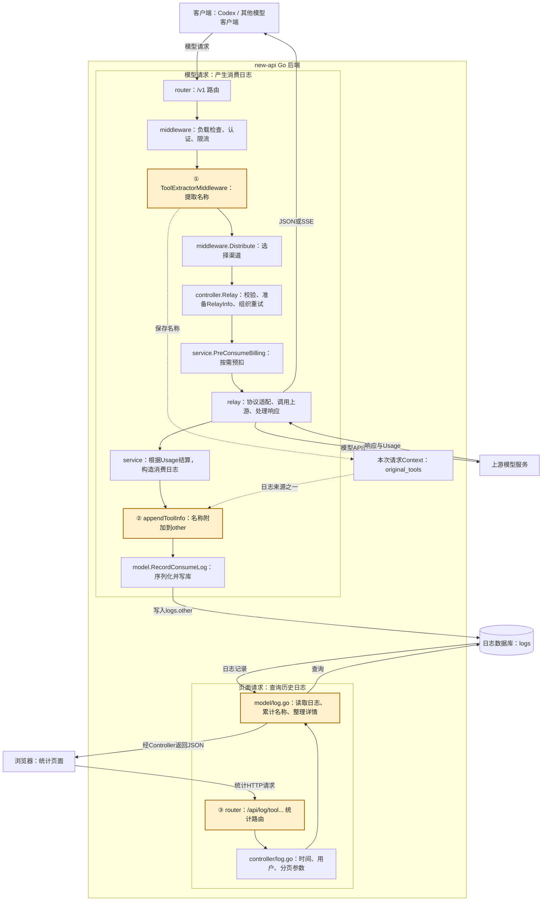
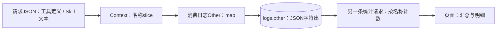

# Tool/Skill统计：模块与完整请求链路

当前源码核对日期：2026-09-17。以下是源码结构与成功文本请求主路径示意，不代表真实模型或数据库端到端验证。

## 1. 先看模块位置

Tool/Skill统计通过请求入口提取、消费日志附加、查询与展示三个接入位置，复用模型网关和日志系统。图中模块是new-api Go后端内的代码职责；`service/`并不表示另行部署的微服务。



图省略全局Request ID、Session等通用中间件、失败退款分支，以及主库/缓存细节；选择文本成功路径观察统计接入点。模型响应可以在适配器处理中返回或流式写出，并非等到日志入库后才开始返回。

## 2. 三处接入如何实现

| 接入点 | 已有位置 | 插入逻辑 | 数据结果 |
|---|---|---|---|
| ① 采集 | /v1组认证、限流之后，Distribute之前 | Use注册ToolExtractorMiddleware；BodyStorage读取JSON，提取名称、过滤内置工具、map去重 | Context中保存original_tools，值为[]string |
| ② 保存 | 正常计费结算生成消费日志时 | GenerateTextOtherInfo调用appendToolInfo，取出名称，写入Other | logs.other的JSON包含tools/tool_count |
| ③ 查询展示 | /api/log路由与消费日志页面 | Controller接收筛选参数，Model查日志聚合；React请求结果并渲染 | data汇总、details日志明细 |

名称在主链中的状态变化：



Context与日志扩展map位于处理该请求的后端进程中；请求之间通过已持久化日志连接。此统计链不通过Redis累计工具次数，不创建单独的工具执行流水表。

## 3. 源码入口

| 模块 | 文件与符号 |
|---|---|
| 路由接入 | `router/relay-router.go:74` / `ToolExtractorMiddleware`注册 |
| 请求提取 | `middleware/tool_extractor.go:87` / `ToolExtractorMiddleware`；`:111` / `extractToolNames` |
| 请求体复用与Context | `common/gin.go:86` / `GetBodyStorage`；`:157` / `SetContextKey` |
| 主流程调度与预扣 | `controller/relay.go:68` / `Relay`；`:164` / `PreConsumeBilling` |
| 上游适配 | `relay/compatible_handler.go:189` / `DoRequest`；`:207` / `DoResponse` |
| 结算与日志准备 | `service/text_quota.go:347` / `PostTextConsumeQuota` |
| 名称附加 | `service/log_info_generate.go:119` / 调用点；`:326` / `appendToolInfo` |
| 日志持久化 | `model/log.go:343` / `RecordConsumeLog`；`:101` / `createLog` |
| 查询接口 | `router/api-router.go:273`；`controller/log.go:198,226` |
| 聚合与明细 | `model/log.go:821` / `SumToolUsage`；`:957` / `SumToolUsageWithDetail` |
| 页面查询 | `web/default/src/features/usage-logs/components/tool-usage-stats.tsx:105` / `fetchStats` |

## 4. 阅读图时保留的边界

- Context是日志名称来源之一；ClaudeHelper也会保存OriginalTools，日志代码优先解析它，成功解析后不再补入Context结果，即使过滤后为空。
- 统计对象是日志中的名称出现情况，不能解释为真实工具执行次数；Quota是整条模型请求的费用。
- MySQL汇总分支有最近2000条日志限制；详情按日志分页。当前页面默认查询第一页20条日志的详情。
- 文本提取覆盖messages用户内容与顶层system，不完整覆盖Responses的input/instructions。
- 个人统计路由挂UserAuth；两条全局Tool统计路由未显式挂AdminAuth，图中不将它们画成已完成管理员鉴权。
- 观察顺序：在提取后看names与Context，在appendToolInfo后看other，在落库前看otherStr，在统计时看toolCounts；再用本地练习日志ID对照页面Network响应。本次未执行该运行观察。

## 5. 中间件到底读什么：请求定义和文本，不是执行结果

`ToolExtractorMiddleware`在`c.Next()`前读取BodyStorage中的原始请求JSON，用gjson访问字段。BodyStorage缓存请求体，使后续参数解析可以重复读取。读取或JSON解析失败时，中间件直接继续后续处理，不在这里生成工具统计记录。

| 来源 | 实际读取位置 | 所能说明的事实 |
|---|---|---|
| 工具定义 | `tools[].name`，其次`tools[].function.name`，再以`tools[].type`兜底 | 本次模型请求携带了该工具定义或类型 |
| 旧函数定义 | tools不存在或不是数组时，读取`functions[].name` | 本次模型请求携带了该函数定义 |
| Skill命令文本 | `messages[]`中role=user的content，正则匹配`/skill-name` | 用户文本中出现了这个名称，可能来自历史消息 |
| Skill元数据文本 | 顶层`system`中的`name: skill-name`或斜杠命令 | 系统文本包含该名称，不证明Skill已执行 |

中间件过滤已列举的内置工具，并通过`map[string]struct{}`在本次请求内去重。`extractTextFromContent`中的`type=text/tool_result/tool_use`用于选择如何读取嵌套文本，不是按tool_use事件累计执行次数。当前没有遍历Responses的`input`、`instructions`来完整识别Skill，也没有读取本机SKILL.md文件。

以下为缩减的教学请求片段，不是实际请求或凭据：

```json
{
  "tools": [
    {"type": "function", "name": "query_km"},
    {"type": "function", "name": "create_ticket"}
  ]
}
```

中间件会得到query_km和create_ticket两个名称；本次请求进入消费日志保存路径后，`other`中包含：

```json
{
  "tools": ["query_km", "create_ticket"],
  "tool_count": 2
}
```

名称顺序不保证固定。即使模型只返回普通文本、没有调用任何一个工具，这两个名称仍可进入日志。`tool_count`是本条日志保存的名称数量；看板`call_count`是在查询时遍历历史`other.tools`累计的名称出现次数。

| 教学日志 | other.tools | 请求费用quota |
|---|---|---|
| L1 | query_km、create_ticket | 100 |
| L2 | query_km | 60 |

汇总为query_km=2、create_ticket=1。明细把L1同时归入两个名称，且都携带整条请求的quota=100，因此不能把两个工具的关联费用相加当作平台总费用；平台这两条请求实际累计额度为160。数值均是假设内部额度，不代表货币金额。

`SumToolUsage`当前实际在Go中解析JSON并执行`toolCounts[name]++`，不要把注释提到的MySQL JSON_TABLE写成已实现逻辑。MySQL分支只查询筛选范围内最近2000条日志，通用分支按2000条批量读取；两者的过滤和扫描范围也不完全相同。

## 6. Responses的type解析是另一条计费链

`relay/channel/openai/relay_responses.go:120`中的流式响应处理确实检查：

```text
外层事件 type = response.output_item.done
  → item.type = web_search_call
  → ResponsesUsageInfo.BuiltInTools[web_search_preview].CallCount++
```

`service/text_quota.go:90`读取这组内置工具计费用量，`:436`附近将其写为`other.web_search_call_count`等字段。`SumToolUsage`读取的却是`other.tools`名称数组，不读取这些计费计数。不能将这两条链合称为“Tool/Skill看板通过Responses事件统计所有真实调用”。

若以后希望统计自定义工具的真实执行，需要明确三个阶段：请求提供工具定义、模型生成工具调用指令、客户端执行工具并返回结果。应按稳定的call_id关联并去重，还需客户端执行结果或独立埋点才能判断成功、失败和耗时；不能直接把每个SSE数据块当作一次调用。此处仅说明后续设计边界，当前没有实现该执行事件链。

## 7. API Key看板如何复用同一批日志

普通API Key请求由`middleware/auth.go:529`的`SetupContextForToken`写入用户ID、token_id、token_name；`relay/common/relay_info.go:494`将token_id复制到RelayInfo；结算时`service/text_quota.go:491`传给`RecordConsumeLog`，与模型、时间、Token用量和quota一起保存到logs。

这里token_id是API Key记录ID，prompt_tokens/completion_tokens是模型文本用量，二者含义不同。OAuth认证路径另有token_id=0的约定，因此按日志token_id分组不能自动识别每一枚OAuth访问凭据。

`web/default/src/features/usage-logs/components/key-usage-stats.tsx:90`请求`GET /api/log/stat`，携带时间、可选用户名与Key名称。Controller调用：

- `SumUsedQuota`：筛选区间的消费额度；RPM/TPM另查最近60秒。
- `SumUsedQuotaDetails`：按`user_id, username, token_id, token_name`分组，SUM额度和输入/输出Token，COUNT消费日志，按total_tokens降序。

Key看板拿到quota/rpm/tpm/details后渲染汇总卡片和明细表，不重新解析模型请求或响应。此接口聚合消费日志，COUNT并不是所有到达网关的请求数，也不是工具调用数。

## 8. 两类看板与四个接口的准确对应

| 接口（均为GET） | 用途 |
|---|---|
| `/api/log/tool_stat` | Tool/Skill全局汇总 |
| `/api/log/tool/self_stat` | 当前用户Tool/Skill汇总 |
| `/api/log/tool_stat/detail` | 全局汇总以及分页日志明细 |
| `/api/log/tool/self_stat/detail` | 当前用户汇总以及分页日志明细 |

四个接口均属于Tool/Skill。API Key看板复用`/api/log/stat`的details扩展；不是Tool和Key各两个接口。

Tool页面根据isAdmin选择全局或个人明细接口，从data计算名称总次数、名称种类数和最高占比，从details展示关联请求。当前前端没有传入分页参数，使用后端默认第一页20条日志；total_count表示匹配日志条数，不是所有工具名称次数之和。页面上的角色选择不能替代后端鉴权，全局两个Tool路由目前只有显式限流，未挂AdminAuth。

按当前实现可表述为：“复用消费日志体系，增加Tool/Skill名称关联统计和API Key用量看板，提供4个Tool/Skill汇总/明细接口，支持关联用户、Key、模型和时间追溯请求消耗。”不要将其扩写成已实现工具执行成功率、Skill任务完成率或精确的逐工具成本核算。

## 9. 一次用户任务、多次Responses请求：为什么不能称为调用次数

2026-09-17继续核对 `/Users/w/codex_0_2_6` 的客户端源码。CodeGraph命令报数据库无法打开，因此回退到定向源码读取。以下是根据实际请求构造和协议重建的教学场景，不是生产抓包；没有读取用户凭据或执行真实模型请求。

必须分别计量：用户提交的任务/Turn、客户端发出的模型API请求、模型返回的工具调用指令、客户端实际执行。它们不是一一对应；网关内部的上游重试又是独立层次。

客户端证据：

- `codex-rs/core/src/client.rs:852`的build_responses_request构造input与tools；普通非Responses-lite分支从prompt.tools序列化顶层tools（:896），并设stream=true（:940）。工具清单会随配置/动态发现变化，不能断言永远固定。
- `codex-rs/core/src/stream_events_utils.rs:296`接到可路由工具调用后安排handle_tool_call，并设置needs_follow_up=true。
- `codex-rs/core/src/session/turn.rs:2267`等待工具任务并将结果写入会话历史；外层循环在:421读取历史，:439再次发起采样请求。
- 已有测试`codex-rs/core/tests/suite/tool_harness.rs:61`构造第一次响应中的shell_command调用、第二次响应中的最终文本，并在:127检查第二次请求中携带命令结果。本轮仅读取测试代码，未运行该测试。

设一个用户任务始终提供三个普通函数工具query_km、read_doc、create_ticket，并且三次请求都成功记录一条消费日志：

| 模型请求 | 请求里的工具定义 | 本次响应新生成的调用 | 当前名称统计增量 |
|---|---|---|---|
| R1 | 三个工具 | query_km一次 | 三个名称各+1 |
| R2 | 三个工具 | query_km一次、read_doc一次 | 三个名称各+1 |
| R3 | 三个工具 | 无工具调用，返回最终文本 | 三个名称各+1 |

结果：当前看板query_km=3、read_doc=3、create_ticket=3；模型新发出的调用实际为2、1、0。若这些指令全部实际执行且各执行一次，执行数才也是2、1、0；不能从模型指令直接推定执行成功。

工具调用本身出现在新响应的output项或SSE的item中，例如`type=function_call`、`name=query_km`、`call_id=call_demo_1`；执行结果以`type=function_call_output`携带同一个call_id返回。后续请求的input可能重复包含这些历史调用和结果，如果改成遍历input却不去重，仍会重复计数。对于模型发起调用的指标，可在新响应的`response.output_item.done`处按item类型记录一次，并用响应标识和call_id/item_id建立幂等关系；真正执行、拒绝、失败和耗时需要客户端执行事件或明确的结果协议支持。

当前计数更接近工具定义随请求被携带的频次，适用于检查请求附带了什么工具配置。工具集固定时，未调用工具也可能与高频使用工具一起增长，不能支持工具使用率/热门工具排行的业务解释，也不能据此分摊工具成本。

此外，该本地Codex版本支持namespace工具（`codex-rs/tools/src/responses_api.rs:52`）；现有中间件只取顶层name，不递归内部tools，可能记成namespace名称。Responses-lite分支把工具放到input的AdditionalTools项，当前顶层tools解析也覆盖不到。上表限定普通HTTP Responses、顶层function工具和正常日志路径，不将其扩展为所有传输/工具模式。

协议对照：[OpenAI Function calling](https://developers.openai.com/api/docs/guides/function-calling)。官方示例区分提供tools、接收function_call、执行函数和回传function_call_output；流式参数delta不代表独立调用。

## 10. 从DeepSeek接入调试解释响应侧统计与Skill识别

用户补充的历史背景：接入DeepSeek Chat模型后观察到效果不理想，曾将返回转换成Responses并分析模型输出中的工具类型和数量。这一经历按用户口述记录；本轮没有取得那次历史流量、提交或持久化统计代码，不能用当前请求名称计数实现替代它的证据。

面试叙述可以围绕“接入效果差异 → 排查协议适配及工具调用链 → 比较响应调用事件 → 关联平台日志、Key消耗和看板”展开。不能用“只看到function_call”直接推出“只能调用一个工具”或“模型能力弱”：function_call是一类封装，不同name仍可代表执行命令、读文件、查询知识库等多种功能。转换器自身也会影响最终类型分布。

本地Codex的ToolSpec当前有function、namespace、tool_search、web_search、custom五个变体；这是该版本的请求工具定义枚举，不是Responses完整协议只有五种工具或返回项。namespace是工具分组，内部调用仍可以是function_call。ResponseItem还包含message、reasoning、调用及结果等多个变体，不应对output数组长度直接计工具次数。

当前网关转换证据：

- `service/relayconvert/internal/oai_chat/to_oai_responses_resp.go:172`把Chat的函数型tool_calls映射成function_call，保留ID、name和arguments。
- `service/relayconvert/internal/oai_chat/to_oai_responses_stream_resp.go:194`按Chat tool_calls的index保存状态、拼接参数，`:279`生成每个工具的完成事件。
- `relay/channel/openai/responses_via_chat.go:65`是流式转换接入点。适合讨论在此转换之后与原生Responses解析之后共用响应项收集逻辑；当前并未核实已有统一收集器写入工具看板。
- `service/relayconvert/internal/oai_responses/to_oai_chat_req.go:321`处理工具定义转换。转换JSON结构或透传未知类型不能让上游自动获得对应的托管工具能力。

若实现响应侧统计，建议在解析完成的事件层记录request_id、response_id、call_id/item_id、上游协议、模型/渠道、工具类型、namespace/name和是否经过转换。对新响应的完整调用项计一次，流式delta不累计，response.completed重新携带output时不重复计数；非流式遍历最终output中的调用项。这里统计的是模型发起调用数，执行成功/失败须另关联客户端结果。中间件负责提供用户与Key等请求身份，协议适配/响应解析层负责读取流式事件。

比较同类任务时应同时核对工具是否提供给模型、名称是否正确映射、参数是否合法、结果是否配对和模型是否继续使用结果。工具类型分布用于定位能力路径和适配问题，不能把类型更多、调用更多直接解释为效果更好。

Skill在这份Codex协议中没有统一的skill_call返回类型：

- 显式选择：`core-skills/src/injection.rs:72`解析已选择的Skill并读取正文，成功读取后形成SkillInjection和SkillInvocation（Explicit）；失败另记error。
- 注入形式：`core-skills/src/skill_instructions.rs:22`以user角色上下文片段输出`<skill><name>...<path>...正文...</skill>`。它进入后续请求input，不是模型返回的工具调用项；目录列出名称也不证明加载。
- 隐式识别：`core-skills/src/invocation_utils.rs:31`将执行Skill脚本或读取SKILL.md的命令映射到已知Skill；`core/src/skills.rs:51`按当前Turn去重并形成SkillInvocation/扩展回调。该识别可发生在命令实际执行前，不能把它当作执行成功证明。
- 网关观察到exec_command/shell_command读取SKILL.md，只能作为关联线索。显式预加载可能没有对应工具调用；命令封装、路径别名也会影响识别。完整统计需要客户端上报明确的选择/加载/脚本执行事件，并保留事件来源与成功状态。这是建议接入方式，未确认历史new-api已接通客户端埋点。

截至本轮核对，DeepSeek官方已有Responses API兼容接口，并对function及特定apply_patch custom工具列出支持范围。因此描述旧接入时应限定“当时的模型版本和Chat通道”，不说DeepSeek永久只支持Chat/function。参考：[DeepSeek Tool Calls](https://api-docs.deepseek.com/guides/tool_calls/)、[DeepSeek Responses兼容说明](https://api-docs.deepseek.com/guides/responses_api/)。


## 11. Function具体工具与Custom编排的关系

2026-09-18，基于 `/Users/w/codex_0_2_6` 当前源码核对，未读取真实请求凭据或重放生产流量。

- Function是JSON参数调用格式，不是一份DeepSeek内置工具清单。Codex注册的普通工具包括exec_command（终端命令）、write_stdin（进程输入/后续输出）、shell_command（另一种Shell配置）、update_plan、request_user_input、view_image，以及list_mcp_resources/list_mcp_resource_templates/read_mcp_resource。真实发送与可用性取决于环境、功能开关、模型能力、工具暴露模式；图片工具还依赖图像结果兼容。
- Custom exec：`core/src/tools/code_mode/execute_spec.rs:24`注册为Freeform，输入为JavaScript；`code-mode-protocol/src/lib.rs:45`定义公开名称exec。它在V8中组合已注册、允许嵌套的工具。V8本身不直接提供Node、文件系统或网络能力。
- Custom apply_patch：`core/src/tools/handlers/apply_patch_spec.rs:18`注册为Freeform，输入为补丁文本，用于新增、修改、删除文件；不是JavaScript。Custom描述输入方式，不能直接等同代码编排。
- Code Mode等待工具wait仍是Function（`core/src/tools/code_mode/wait_spec.rs:32`），与等待终端进程的write_stdin用途不同。

兼容限制有直接源码依据：`codex-api/src/endpoint/chat_completions.rs:470`的chat_tool_from_responses_tool在type不为function时返回None。因此走此内核Chat适配路径时，custom exec、custom apply_patch和其他顶层非function定义被过滤，namespace中的函数也不会自动展开。该文件对历史CustomToolCall记录的转换不等同于注册Custom工具。CodeModeOnly还可能让普通工具只作为exec内部工具暴露，不能承诺所有Function在Chat请求中都存在。此结论只针对该适配器；若网关另做Responses转Chat，需要核对网关转换逻辑和历史配置。

内部执行不是另一套工具库：`tools/src/code_mode.rs:110`将Function、Freeform和Namespace内部函数转为嵌套工具定义；`core/src/tools/spec_plan.rs:457`依据配置、exposure和排除列表筛选。`core/src/tools/code_mode/execute_handler.rs:123`接收Custom输入；`code-mode/src/runtime/callbacks.rs:66`发出RuntimeEvent::ToolCall；`core/src/tools/code_mode/mod.rs:293`把嵌套调用派发到共用运行时，并将结果交回代码。

普通逐步模式可表现为模型提出A调用、读结果、提出B调用、读结果；Code Mode可在模型一次生成的代码中执行A、解析结果、决定B参数、执行B，再选择输出给模型。依赖步骤仍须等待；独立步骤可并发；需要模型重新理解的下一步仍要回模型。普通Function也可一次请求包含多个调用，或通过Shell脚本、显式代码执行Function完成批处理，不能宣称Function天生只能做简单动作。

计数示例：响应出现一个exec调用，内部调用三个工具，外层调用数为1而内部调用数为3。响应侧只能直接统计外层请求的调用项；精确内层次数与成功状态需要客户端运行时事件。不能仅比较function_call/custom_tool_call总数推出任务效果或效率。


## 12. 从工具定义、Chat适配到Trace和调用统计的完整排查线

2026-09-18，用户确认历史DeepSeek问题trace已经不存在，并明确当前DeepSeek已经支持Responses。本节为当前源码分析和协议教学示例，不能作为历史请求重放、性能测量或故障根因的运行证明。

### 12.1 经典Function定义与实际调用

Function定义包含name（工具名）、description（作用）、parameters（JSON Schema）。常见工具为exec_command(cmd等)、write_stdin(session_id/chars等)、shell_command(command等)、update_plan(plan/explanation)、request_user_input(questions)、view_image(path等)及MCP资源列表/读取工具(server/cursor/uri)。是否发送由环境、功能开关、ToolMode和工具暴露方式决定，不能把源码所有定义当成每轮完整tools数组。

Codex的ToolSpec有function、custom、namespace、web_search、tool_search五种定义变体；namespace分组里仍可放Function，并不是第五种独立执行动作。apply_patch与exec均为custom，输入分别为补丁文本与JavaScript。Code Mode可嵌套执行允许暴露的普通函数和自由文本工具。

### 12.2 两个不同转换位置

- 内核Chat路径：core/src/client.rs构建统一请求 → codex-api/src/endpoint/chat_completions.rs转换 → 上游Chat API。chat_tool_from_responses_tool:470仅保留顶层function，其他定义过滤；返回tool_calls由flush_tool_calls:657构造统一FunctionCall，不生成CustomToolCall。
- 网关转换路径：Codex发送Responses → new-api responses_via_chat → 上游Chat API。service/relayconvert/internal/oai_responses/to_oai_chat_req.go:321仅正规转换function，其他type保留原始定义到Custom字段；没有实现namespace展平、custom代码字符串包装与回传转换、托管搜索或动态工具发现。保留原始字段不能证明旧Chat上游能够接受。
- MCP业务工具特殊性：当前core/src/tools/handlers/mcp.rs:232将业务工具包装为Namespace(Function)，因此内核顶层function过滤会排除它们。list_mcp_resources等三个资源工具仍是普通顶层function，不等于业务工具本身。
- view_image特殊性：函数定义可保留，但Chat桥丢弃图像内容，因此仅工具schema保留不等于模型能理解图片。

### 12.3 Trace记录点决定它能证明什么

本地trace目录由CODEX_ROLLOUT_TRACE_ROOT指定，包含manifest.json、trace.jsonl和payloads；debug trace-reduce只是生成派生state.json。应先以trace事件和raw_payload_id识别来源，而非按任意payload文件名猜网络请求。

本版本的内核Chat路径顺序：

1. core/src/client.rs:1597构建统一ResponsesRequest。
2. :1613 record_started记录该转换前请求。
3. codex-api/src/endpoint/chat_completions.rs:181调用convert_request，:182生成真正Chat JSON body。
4. Chat返回被适配成ResponseEvent::OutputItemDone(FunctionCall)。
5. core/src/client.rs:2202收集统一响应项，:2226写完成trace。

因此trace中tools带custom exec不等于DeepSeek实际收到exec，trace回复只有function_call也可能只是适配层输出格式。若转换发生在网关，客户端trace也不能展示网关内部转给上游的Chat请求。需要同时对照转换代码与上游请求/回复观测。

建议沿同一turn检查四个证据：暴露了哪些工具 → 实际发给上游哪些定义 → 返回哪一个name/arguments或input → 客户端是否执行成功、结果是否正确回到下一轮。再统计模型往返、重复操作、参数错误、执行失败和任务完成度。已暴露却没选用、定义被适配过滤、执行失败是不同问题。

### 12.4 中间件统计的真实边界与可扩展位置

当前ToolExtractorMiddleware读取请求定义及Skill文本线索，写Context后由appendToolInfo持久化other.tools/tool_count；SumToolUsage对每条日志中的名称加一。这不是响应侧的实际调用计数，也不能单独推导模型能力。

若扩展实际调用统计，可由中间件初始化请求ID、用户/Key和统计容器；原生Responses的relay/channel/openai/relay_responses.go:83解析事件，Chat转Responses的responses_via_chat.go:113得到统一事件，在这些语义解析点收集完整调用项；请求结束再持久化。统计应按request_id、upstream_attempt、response_id及call_id/item_id去重，delta不按次数计，completed.output不重复累计。当前已有web_search用量计数是另一条计费链，不能当成已实现通用调用看板。

输出项完成只表示模型生成调用完成。客户端执行结果（包括失败/拒绝/取消）须结合后续call_output或客户端运行时事件；重复携带的历史结果不能重复计数，最后一轮结果可能根本不再经过网关。Code Mode外层exec一次可含多个内部调用；内部数量和耗时须采集运行时事件，不能靠正则扫描JavaScript。

面试叙述应保留：用户陈述曾人工比较trace；当前源码证明工具暴露与适配限制、名称关联看板；完整响应调用采集是本节解释的扩展设计，未证实历史已实现。当前DeepSeek官方Responses文档支持Function，Custom仅支持apply_patch，其他custom名字报400，说明协议接口可用仍需逐项检查工具支持范围。


## 13. Namespace是否会使工具全部丢失，以及GPT和DeepSeek的公平比较

2026-09-18继续只读核对内核。完整教学JSON见 `docs/examples/codex-tool-protocol/README.md`；原始历史trace已不存在，本节不作历史运行或根因复现结论。

- 路由依据是wire_api及会话override：model-provider-info/src/lib.rs:173匹配chat_model_prefixes，core/src/client.rs:1966选择Responses或Chat；不是按GPT/DeepSeek品牌决定工具支持。GPT经过相同Chat桥也丢失相同类型。
- merge_into_namespaces（core/src/tools/spec_plan.rs:539）只合并已有Namespace，:561原样保留其他定义；不会把exec_command/update_plan/custom exec全部包入Namespace。MCP业务工具、V1多代理、配置了namespace的V2多代理和动态工具则确实可能是Namespace。
- ConfiguredModelProvider的namespace_tools在model-provider/src/provider.rs:265固定为true，并未因wire_api=Chat自动关闭或flatten，所以可能在统一请求中包含Namespace，随后被Chat过滤。
- Chat转换仅保留顶层Function。若全是Namespace或其他非Function，chat_completions.rs:326清空tool_choice，:46的skip_serializing_if使tools也完全省略。结果是普通文本Chat请求，而非保留namespace内部Function。
- CodeModeOnly先隐藏可嵌套的直接工具（spec_plan.rs:434），之后Chat又过滤custom exec，可能只剩wait或询问用户等入口。这是源码存在的条件分支，未确认历史DeepSeek配置使用过。
- 原生GPT示例可返回custom_tool_call(exec)并在V8中调用终端和知识库，或返回function_call(namespace=kb,name=search)。Chat示例只返回exec_command函数调用，桥接后namespace=None；定义过滤不会在响应转换时被补回来。
- 典型可推演影响：命令工具仍可读写本地文件和测试，专用patch入口消失但Shell仍有替代方式；MCP查询/多代理若被Namespace过滤则该入口不可用；CodeMode编排缺失可能增加模型往返；image定义虽能保留但图像内容丢失。缺失类型不是速度或完成率的实测数值。
- 验证：当前源码核对及教学JSON语法检查；没有运行示例中的工具、请求上游、执行Rust转换器或重放历史trace。


## 14. 仅修改new-api的模型工具调用检测方案（尚未实施）

2026-09-18，用户粘贴网关侧Skill/Tool方案，并要求以DeepSeek历史接入排查为背景，重点考虑工具调用检测。以下为源码核对后的设计讨论，业务代码未修改，未声称已实现历史响应统计。

口径：请求中声明的工具、模型生成的调用、客户端实际执行结果分开记录；本阶段交付网关观察到的模型调用。五类ToolSpec是定义形式，namespace内部调用仍是function_call加namespace；Custom不都执行JavaScript，exec才是Code Mode，apply_patch输入是补丁；一轮任务/一次响应均可含多个ResponseItem。

推荐在共同controller.Relay生成RelayInfo后初始化Collector，覆盖/v1和Codex专用路径；网关选路/重试开始时记录attempt、channel、requested/upstream model及入站/上游协议。请求侧记录实际可见工具定义；若转换发生在网关，可比较转换前后；若转换早已发生在Codex内核，网关无法观察之前被过滤的定义。

响应采集复用现有语义解析器：原生Responses在relay/channel/openai/relay_responses.go的SSE data及非流式responseBody读取完整调用项；原生Chat在relay-openai.go按choice/tool index合并片段；responses_via_chat转换后的事件接统一Collector，同一桥接路径只采一次。不要另建缓存整个流的ResponseWriter中间件。

当前dto/openai_response.go:363的ResponsesOutput缺namespace和custom input等字段。建议在采集侧使用独立窄结构加json.RawMessage，从原始事件读取必要字段（common JSON wrappers）；不改现有透传语义，不把DTO字段缺失误说成网络转发丢字段。

识别allowlist：function_call、custom_tool_call、web_search_call、tool_search_call等已支持调用；message/reasoning及调用结果不增加调用生成次数。按类型提取name/namespace/call_id/item_id；新增工具类型须单独补规则。output_item.done与completed.output按同一响应内稳定ID去重，参数delta不计次数；完成项生成、响应结束和工具执行成功是独立状态。现有StreamStatus正常EOF不能直接证明模型协议完整结束。

存储建议：一张调用观察明细记录用户/凭据类型、thread/turn、gateway_request_id、attempt、response/call/item ID、工具类型/namespace/name、观察时间和生成状态；event_key唯一约束幂等，结果状态默认unknown。消费日志附关联摘要，旧other.tools名称口径保留版本标记。不要把整笔模型费用摊成已知的单工具成本。

关联元数据：Responses请求体client_metadata优先，HTTP兼容x-codex-turn-metadata回退；内部转Chat会丢body metadata但当前源码保留兼容header。x-client-request-id在该客户端等于thread_id，不能代替每请求唯一ID。网关自己生成request_id；thread/turn仅用于分组，不能把同轮多次推理合并为一次调用。若以后支持Responses WS，按每条推理消息解析metadata，不用连接握手快照代表所有轮次。

Skill无需先改内核：本机通常在~/.agents/skills、项目.agents/skills及兼容/系统/插件目录；请求中<skill><name>…<path>…可作注入证据。隐式读取SKILL.md或skills.read须关联工具请求/结果；复杂JS中的路径只作线索。历史重放、同轮重复注入和跨轮再次加载要分开；没有可靠历史边界时记首次观察/归属未知，不冒充新加载。网关无法保证覆盖所有本地加载或所有Code Mode内部执行。

验收设计：只声明工具无调用=0；同调用30个delta+done+completed=1；namespace函数保留namespace维度；同轮两个不同call_id=2；旧input重放不新增调用；外层exec含三段工具代码仅计一个外层调用；中途断流与客户端执行状态保持可区分。二期再关联Skill证据和客户端回传结果。

面试归因：可以说明用户当时观察到慢和任务能力不足，并通过trace/响应类型排查适配链；当前源码证明Chat桥能力损失。工具类型分布本身不是根因或效果评分，需结合实际暴露工具、重复调用、参数错误、任务结果和耗时。Function也可批量或执行Shell脚本，找文件再读尾部的例子不证明只有Code Mode能做到。
