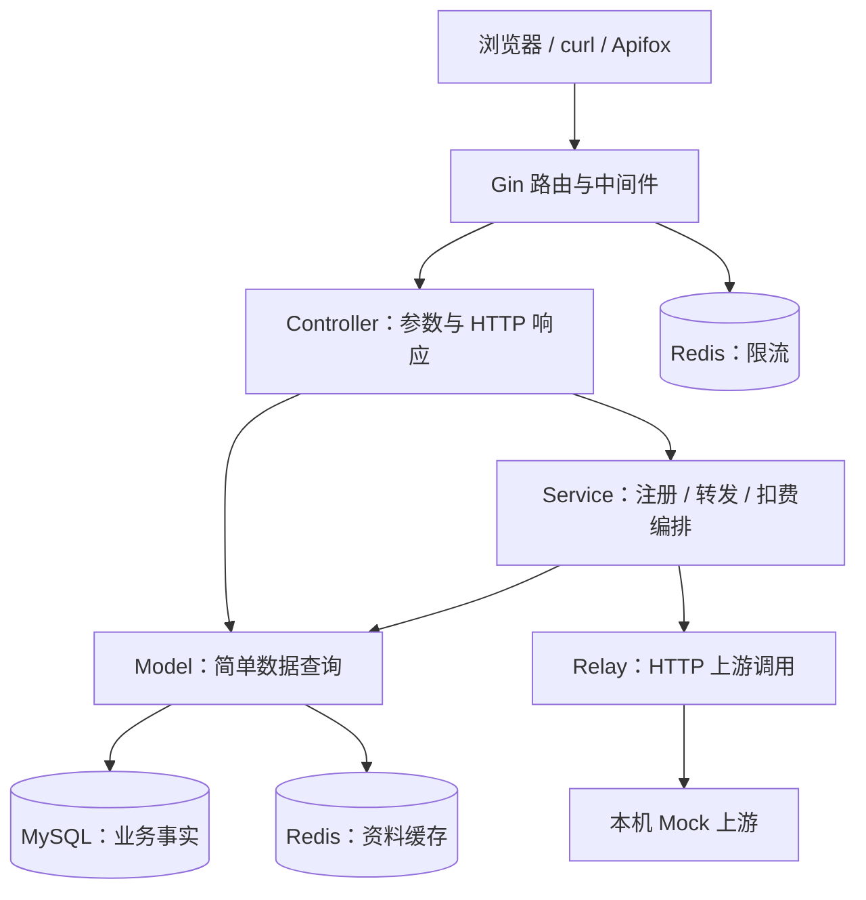

# Mini new-api：亲手构建 Go 后端的学习路线

创建日期：2026-09-06。具体步骤、实际运行证据和掌握状态见 [练习项目学习进度](/Users/w/personal_study/new-api/docs/learning-progress.md)。

> 2026-09-08教学更新：实际练习项目为 `/Users/w/personal_study/new-api`，module为new-api；采用根目录go.mod与app/main.go，根目录执行 `go run ./app`。助手只读核对学习者代码，在对话给局部代码与解释，不写入练习文件。以下初版的Mini命名与app独立模块路径仅保留作原规划背景，执行时以此更新和练习项目学习进度为准，不从代码存在推断运行成功或掌握。

目标：参考当前 new-api，由学习者亲手做出一个精简模型网关，理解一个 Go 服务怎样组织、启动、接收请求、访问数据库、使用缓存并处理失败。课程面向 Go 后端基础和求职表达，不追求复刻完整平台。

本目录保留原始课程与参考项目对照资料。练习代码由你创建和补全；助手负责拆解、提示、源码对照和评审，不代写文件、不自动修复。2026-09-08起，练习项目的当前进度以 [练习项目学习进度](/Users/w/personal_study/new-api/docs/learning-progress.md) 为主，[练习项目学习路线](/Users/w/personal_study/new-api/docs/learning-plan.md) 为当前路线。只有你明确说“搞懂了”才勾选掌握。

2026-09-08补充：[服务端岗位能力与整体架构分析](/Users/w/ruijie/new-api/learning/mini-new-api/backend-capability-framework.md)对照分布式、微服务、高并发、MQ及可观测性要求，提出“单体 → 多实例 → 独立统计服务”的扩展路线。该文档是分析建议，尚未实施，也未替换下面的原始课表。

## 1. 为什么选这个精简项目

推荐做 **Mini new-api：带用户、API Key、渠道、调用记录和模拟额度的单体模型网关**。

| 路线 | 收获 | 本次取舍 |
| --- | --- | --- |
| 用户或待办 CRUD | 容易入门，适合练 HTTP 和数据库 | 作为前半程；后续需要真实业务引出缓存、并发和外部调用 |
| 逐目录阅读完整 new-api | 可以认识现有能力 | 每课只读相关源码，不把全部供应商和配置当作课程范围 |
| 一个持续演进的精简网关 | 能连起管理接口、模型调用、存储、限流和失败处理 | 本次采用；每次只增加一个可观察能力 |

承接已有进度：你最近正在理解 module、package、多个 main 入口，以及 Gin 的请求链。第一课从“自己建立模块并跑通一个接口”开始。此前四个 Go demo 保留作参考；新课程使用一个持续演进的项目。

### 最终使用场景

1. 用户注册并登录，用 Cookie 访问自己的资料。
2. 用户创建自己的 API Key，给程序调用模型接口使用。
3. 管理员配置一个本机模拟渠道和模型名。
4. 调用者携带 API Key 发请求；网关校验身份、检查限流、确定渠道并转发。
5. 用教学积分演示额度预留、成功确认、失败退款，并留下调用记录。
6. 用户查看自己的调用历史；重复请求、并发请求和故障都有可解释的结果。

先用 curl 或 Apifox，不开发前端。上游先用本机 Mock HTTP 服务，不需要真实模型账户或付费。模拟服务是实际 HTTP 对端，但返回内容和用量都是受控的测试数据。

### 核心范围与选修

- 主线：Go 工程组织、Gin、GORM、MySQL、注册登录、权限、API Key、一个渠道、非流式转发、整数额度、Redis 缓存和原子限流、测试调试、本机部署。
- 选修：SSE、第二种上游协议、小接口与替换实现、多渠道优先级/重试、后台补偿、OAuth、跨数据库运行验证。
- 暂缓：前端双主题、真实支付、复杂动态定价、订阅套餐、40 多种供应商、微服务/Kubernetes。学到相关问题后再决定是否扩展。

## 2. 先看整体，再走一条请求



这是练习项目的最终职责图，各部分按课程逐步加入。Redis 缓存和限流是两个独立用途，不是每条请求都经过 Redis。简单查询可以直接 Controller → Model；跨多项操作的业务由 Service 编排。

**先掌握的链路：** `GET /api/status → Gin → Handler → JSON`。

**第一条完整业务链：** `注册 → users 行 → 登录校验 → Cookie → GET /api/user/self → UserAuth → GetSelf → GORM → MySQL → JSON`。

**最后串起的模型链：** `API Key → TokenAuth → Redis 限流 → RelayService → MySQL 预留额度 → HTTP Mock → MySQL 确认或退款 → JSON`。外部 HTTP 调用放在数据库事务之外。

### 谁创建对象，数据放在哪里

| 对象 | 创建/执行者 | 生命周期和用途 |
| --- | --- | --- |
| 配置、Gin Engine、数据库连接池、Redis/HTTP 客户端 | `main` 启动时组装 | 通常由服务进程长期复用，退出时按资源类型关闭 |
| `*gin.Context` | Gin 处理每次请求时提供 | 请求内读参数、写响应、传递认证结果；不保存给后续请求使用 |
| 标准库 `context.Context` | 从请求派生、按需设置超时 | 把取消与截止时间传给 GORM、Redis、HTTP 客户端 |
| 用户、API Key 摘要、渠道、调用记录 | 业务代码经 GORM 写入 | 存在 MySQL，进程重启后仍可读取 |
| 登录 Cookie | 服务端设置，客户端后续携带 | 主线采用成熟签名 Cookie Session；不把登录事实想当然地放在 Redis |
| 缓存项、限流计数 | 对应业务/中间件操作 Redis | 有各自的 key、TTL、更新和故障策略 |

## 3. 文件夹如何逐步长出来

目前已有的文件：

```text
learning/mini-new-api/
├── README.md                     本教学路线
├── AGENTS.md                     助教行为约定
└── lessons/01-first-request.md   第一课任务卡与填空骨架
```

你从第一课开始创建 `app/`，并在其中建立独立 `go.mod`。它有自己的模块依赖；运行和测试命令从 `app/` 执行。不要在 new-api 根目录误执行课程的 `go mod init`、`go get` 或 `go mod tidy`。

下面是最终可能形成的结构，**不是今天需要创建的空目录清单**：

```text
app/
├── go.mod / go.sum
├── cmd/
│   ├── server/main.go       网关程序入口
│   └── mock/main.go         模拟上游入口，学到转发时创建
├── internal/
│   ├── config/              配置解析
│   ├── router/              路由和依赖组装
│   ├── middleware/          Request ID、认证、限流
│   ├── controller/          HTTP 参数与响应
│   ├── service/             有业务组合需求时加入
│   ├── model/               GORM 模型和数据操作
│   ├── relay/               上游 HTTP 调用与协议转换
│   ├── dto/                 请求/响应结构体
│   └── common/              少量稳定共用能力，例如 JSON 包装
└── compose.yaml             MySQL/Redis 本机练习依赖，后期再加应用服务
```

第一课只写 `app/main.go`。理解一个文件以后再拆包，随后迁到 `cmd/server/main.go`；迁移时不能保留两份重复入口。每新增一层都解释“它解决了当前哪个问题”。不提前建立 Repository 接口、依赖注入框架或通用 BaseService。

## 4. 最小业务设计

### 数据模型按需加入

| 表 | 最小字段/约束 | 教学目的 |
| --- | --- | --- |
| `users` | id、唯一 username、password_hash、display_name、role、status、quota、created_at | 结构体映射、唯一约束、身份、整数余额 |
| `tokens` | id、user_id、name、key_hash、status、expires_at；key_hash 唯一 | 一对多关系、密钥摘要、吊销、资源归属 |
| `channels` | id、name、base_url、model、status | 上游配置；先只支持一个协议和一个模型 |
| `usage_logs` | id、user_id、token_id、channel_id、request_id、idempotency_key、request_hash、status、cost、created_at | 调用追踪、事务、状态流转、幂等 |

主线 MySQL 练习库统一保存上述表，使单次业务事务的边界可观察。`usage_logs` 后期增加 `(user_id, idempotency_key)` 唯一约束；Request ID 用于追踪单次尝试，幂等键用于识别同一次业务操作，两者分开。

主线 API Key 不设置第二套独立余额；余额只归 User 所有。采用固定正整数成本，例如每次成功调用消耗 1 个教学积分，避免把真实金额和复杂 token 定价带进入门课。模拟初始额度只在本地练习数据中设置，不做支付接口。

### 最小接口

| 接口 | 用途/权限 |
| --- | --- |
| `GET /api/status` | 检查 HTTP 服务是否能应答，不宣称数据库健康 |
| `GET /readyz` | 后期检查本课配置的必要依赖是否可用 |
| `POST /api/user/register`、`POST /api/user/login` | 注册、密码登录 |
| `POST /api/user/logout` | 注销当前客户端的 Session |
| `GET /api/user/self`、`PUT /api/user/self` | 登录用户读取/修改自己的公开资料；不允许自改角色或额度 |
| `POST /api/tokens`、`GET /api/tokens`、`DELETE /api/tokens/:id` | 登录用户管理自己的 Key |
| `POST /api/channels`、`GET /api/channels` | 本地管理员管理模拟渠道 |
| `POST /v1/chat/completions` | API Key 认证，教学版非流式模型调用 |
| `GET /api/logs/self` | 登录用户分页查看自己的调用记录 |

接口命名用于帮助回看 new-api，HTTP 错误约定采用明确的 400/401/403/404/409/429/500/502/503/504；不机械复制现有所有历史响应格式。模型接口只实现约定的 `model`、`messages` 和非流式结果子集，不宣称完整 OpenAI 兼容。`stream: true` 在 SSE 选修前应明确拒绝。

## 5. 教学步骤：12 个阶段，26 节小课

这是学习顺序，不是固定周计划。每节约 45–90 分钟可作为安排参考，卡住时拆成多次；以你能复述和验证为准。每次对话推进一个小课目标。

### 阶段 0：从一个 Go 文件到第一个接口（第 1–2 课）

- **业务结果：** 自己启动进程，`GET /api/status` 返回固定 JSON。
- **第 1 课你做：** 创建独立模块、补全 Gin Engine/GET/Handler/Run；辨认 `go.mod`、package、import、main 函数。
- **第 2 课你做：** 比较 `go run .` 与 `go build`，解释编译目标；对照 new-api 的 `main → InitResources → SetRouter → http.Server`，画启动顺序。
- **Go 穿插：** 函数、短声明、多返回值、`error`、函数作为参数、`*gin.Context` 的最初认识。
- **观察/验收：** 启动终端与请求终端各做什么；实际响应状态和 Body；停止进程后请求为什么失败。能解释“构建时是否执行 main”。
- **源码锚点：** `go.mod`；`main.go:57` 的 `main`、`:177` 的 `gin.New`、`:299` 的 `InitResources`；`router/main.go:16` 的 `SetRouter`。
- **面试关联：** 编译与运行、模块与包、程序入口、进程与端口。

### 阶段 1：Gin 怎样接收和返回数据（第 3–4 课）

- **业务结果：** 用固定的非敏感示例数据练习路径、查询参数、JSON Body；有一致的错误响应。
- **第 3 课你做：** 练 `Param`、`Query`、`ShouldBindJSON`；构造注册 DTO，但暂时不落库；缺字段或格式错误返回 400。
- **第 4 课你做：** 从单文件拆出 router/controller/dto，理解导出名称、import 路径和循环依赖；把 Handler 放在正确的包。
- **Go 穿插：** struct、字段 Tag、指针、零值、`nil`、slice、map；可选字段中“没传”和“明确传 0/false”不同。
- **观察/验收：** 同一接口的正常/错误输入；给 Controller 下断点看绑定前后的 DTO；能说明 HTTP 状态码与 JSON 业务字段的区别。
- **源码锚点：** `router/api-router.go:SetApiRouter`；`controller/user.go:Login`；`dto/`。旧源码的 JSON 调用不作为违反当前 `common` 包装规范的理由。
- **面试关联：** 参数验证、DTO 与数据库模型、Go 值传递、HTTP API 设计。

### 阶段 2：中间件与一次请求的上下文（第 5–6 课）

- **业务结果：** 每个请求携带可追踪的 Request ID，日志显示执行顺序。
- **第 5 课你做：** 注册全局/分组中间件，实现前后日志；画出 `A前 → B前 → Handler → B后 → A后`。
- **第 6 课你做：** 补 Request ID 的生成、传递和返回；为声明只接收JSON的接口添加RequireJSON，检查Content-Type并以415拒绝不支持的格式，用实际接口约束比较 `Next`、`Abort`、`return`、`JSON`。结构与字段校验继续由Controller的ShouldBindJSON负责；后续注册/登录等JSON接口可复用。
- **Go 穿插：** 闭包、回调、作用域、指针共享、`defer`、标准库 context。
- **观察/验收：** 两次请求的 ID 不同，一次请求的日志和响应头 ID 一致；拒绝后最终 Handler 未执行。用 `httptest` 验证中间件顺序。
- **源码锚点：** `middleware/request-id.go:10` 的 `RequestId`；`middleware/auth.go:UserAuth/authHelper`；`router/api-router.go:81` 的用户分组。
- **面试关联：** 中间件链、请求作用域、取消与超时；Gin Context 不等同数据库 Session 或登录 Cookie。

### 阶段 3：先看 SQL，再接 GORM 与 MySQL（第 7–9 课）

- **业务结果：** 用户资料成为数据库行，服务重启后仍存在。
- **第 7 课你做：** 在独立本机库中认识表/行/列/主键/唯一索引，手写最小 `INSERT/SELECT/UPDATE`；解释唯一用户名约束。
- **第 8 课你做：** 补环境配置、`gorm.Open`、连接池设置、连接检查和 User 模型；在练习库使用 `AutoMigrate`，观察实际表结构。
- **第 9 课你做：** 把内存/固定数据查询换成 GORM 的创建、按 ID 查询、分页和更新；区分查不到与数据库故障。临时 CRUD 练习入口在正式认证前仅本机使用，之后收进受保护路由。
- **Go 穿插：** 方法与指针接收者、`&user`、多返回值、错误包装、`errors.Is`；GORM `Updates(struct)` 的零值行为。
- **观察/验收：** 请求 → GORM SQL → 数据行 → JSON 对上；重启不丢用户；重复用户名由数据库约束拒绝；用 `EXPLAIN` 解读查询计划，不能仅因建了索引就断言它被使用。
- **源码锚点：** `model/main.go:134` 的 `chooseDB`、`:188` 的 `InitDB`；`model/user.go:23` 的 `User`、`:391` 的 `GetUserById`。
- **面试关联：** SQL 注入与参数化、主键/唯一索引/普通索引、连接池、ORM 能做什么、迁移边界。

### 阶段 4：注册、登录与自己的资料（第 10–12 课）

- **业务结果：** `注册 → 登录 → /self` 成为第一条完整业务链。
- **第 10 课你做：** 注册时验证输入、bcrypt 哈希密码、处理用户名冲突；响应不暴露 password_hash。把跨步骤注册逻辑放进 Service。
- **第 11 课你做：** 登录验证、签名 Cookie Session、注销；使用成熟库。Cookie 只承载必要身份，角色/禁用状态从当前数据库事实判定。
- **第 12 课你做：** UserAuth 设置请求内 user_id，GetSelf 读取它；加用户归属与管理员权限检查，禁止通过 Body 自提权。Cookie 认证的写接口加入明确的 CSRF 校验策略。
- **Go 穿插：** 包职责、业务错误与 HTTP 错误映射、`c.Set/Get`、依赖显式传递；Service 不必接收 Gin Context。
- **观察/验收：** 错密码、无 Cookie、无权限、禁用用户、修改他人资料、缺少有效 CSRF 凭据的写请求分别失败；正确登录后 /self 成功。Cookie/密码只留本地，反馈时脱敏。
- **源码锚点：** `controller/user.go:40` 的 `Login`、`:144` 的 `setupLogin`、`:469` 的 `GetSelf`；`middleware/auth.go`；`model/user.go:ValidateAndFill/GetUserById`。
- **面试关联：** 认证与授权、密码哈希、Session/Cookie/JWT 职责、CSRF、越权。
- **简化边界：** 不实现企业 SSO、OAuth、双因素；不把 `New-Api-User` 当可信身份来源。签名 Cookie 主线先不做跨设备会话管理，注销清理当前客户端 Cookie 不等于集中吊销所有会话。

### 阶段 5：API Key 与上游渠道（第 13–14 课）

- **业务结果：** 用户给程序创建调用凭据，管理员配置模拟上游。
- **第 13 课你做：** 生成高熵随机 API Key，只在创建响应展示一次，数据库保存摘要；实现列表、吊销、过期和归属过滤。
- **第 14 课你做：** 管理员创建 Channel；TokenAuth 从 Bearer Key 得出 user_id/token_id；选择启用且支持目标模型的单一渠道。上游地址仅来自管理员的本机练习配置。
- **Go 穿插：** `crypto/rand`、时间、结构体关联、指针可选字段；正常错误路径的早返回。
- **观察/验收：** 用户 A 不能删除 B 的 Key；吊销/过期 Key 不能调用；普通用户不能创建渠道；未知模型有明确错误。
- **源码锚点：** `model/token.go:Token`；`model/channel.go:Channel`；`middleware/auth.go:319` 的 `TokenAuth`；`router/relay-router.go:SetRelayRouter`。
- **面试关联：** 资源归属、API Key 生命周期、一对多建模、管理请求与业务请求的身份边界。
- **简化边界：** Web Cookie、网关 API Key、上游渠道 Key 是不同凭据。Mock 不需要真实上游 Key；练习采用 Key 摘要存储，是教学设计，不声称现有 `Token` 表也如此保存。

### 阶段 6：网关真的转发一次 HTTP（第 15–16 课）

- **业务结果：** 客户端请求经过网关到本机 Mock，再拿回非流式 JSON。
- **第 15 课你做：** 建立第二个 main 包作为 Mock 服务；使用复用的 `http.Client` 构造请求、传递 context、读取/关闭 Body；主线先写具体实现。
- **第 16 课你做：** 将客户端 DTO 与上游 DTO 分开；补未知模型、上游 500、慢响应、错误 JSON、过大响应和客户端取消的处理。确有替换需要时再提取小接口，不复制整个 Adaptor。
- **Go 穿插：** `io.Reader`、`defer Close`、`context.WithTimeout`、隐式接口与错误包装；业务调用返回数据，由 Controller 写 HTTP。
- **观察/验收：** 两个进程都能看到同一请求关联信息；慢 Mock 触发超时；取消能传播；响应读取有上限；传上游的是渠道配置凭据，不是原样转发用户 Authorization。
- **源码锚点：** `controller/relay.go:68` 的 `Relay`；`relay/channel/adapter.go:15` 的 `Adaptor`；`router/relay-router.go:69` 的模型路由组。
- **面试关联：** 服务端既是 HTTP Server 也是 HTTP Client、连接复用、超时预算、依赖倒置的实际用途。

### 阶段 7：事务、并发额度和幂等（第 17–19 课）

- **业务结果：** 一次模型调用的积分和记录一致，并发不会扣成负数。
- **第 17 课你做：** 先只练数据库：固定成本的条件扣减与创建 usage 行放进同一事务，检查 `RowsAffected`；制造第二步失败，观察全部回滚。
- **第 18 课你做：** 连入转发：短事务 T1 创建 pending 记录并预留积分 → 提交 → HTTP 调用 → 明确成功/失败时用短事务 T2 确认或退款，结果未知时保留 pending。所有事务操作用 `tx`，不混用外层 `db`。
- **第 19 课你做：** 用唯一幂等键和状态条件更新阻止重复执行/退款；同键不同请求内容返回冲突。通过明确同步点同时发起有限个请求，验证余额与状态。
- **Go 穿插：** 事务回调、`int64`、受限整数运算、`sync.WaitGroup`/channel 同步；比较 Mutex、SQL 原子更新、事务各自保护的范围。
- **观察/验收：** 2 积分、3 个并发业务请求时最多预留 2 次；失败退款最多一次；成功记录与净扣费一致。Key 成本固定且为正，余额有上界；不接受客户端自报扣费金额。
- **源码锚点：** 先读 `model/redemption.go:137` 的 `Redeem` 和 `model/locking.go:20` 的 `lockForUpdate`，再对照 `service/billing_session.go:41` 的 `BillingSession.Settle`。兑换码是较小的单库事务例子；原项目资金来源与令牌结算分步提交，不是一个数据库事务，不能与练习的单库事务混同。暂不进入动态表达式计费。
- **面试关联：** ACID、隔离级别、条件更新、行锁、幂等、跨 HTTP 与数据库的一致性。
- **教学合同：** 首次完成请求返回模型结果；同键再次请求只返回已有状态/调用 ID，不自动再打上游，也不承诺重放原始模型响应。上游结果未知或进程崩溃留下 pending 时先保留记录，列入人工检查/补偿选修，不能仅凭超时判定“上游未执行”，不能宣称 exactly-once。

### 阶段 8：Redis 做缓存（第 20–21 课）

- **业务结果：** 同一用户的非敏感展示资料可被缓存，重复读取能观察命中。
- **第 20 课你做：** 初始化长期复用的 Redis 客户端，学习 String/Hash/TTL；设计带 `mini:` 命名空间的 profile key。Cache-Aside：读缓存 → 未命中查库 → 回填并设置 TTL。
- **第 21 课你做：** 修改资料先提交 MySQL、再删除缓存；模拟缓存未命中、过期、损坏和 Redis 不可用，补回源与错误日志。
- **Go 穿插：** 序列化、时间单位、`redis.Nil` 与连接错误、请求 context；业务 JSON 操作遵守本项目 `common` 包装约定。
- **观察/验收：** 第一次查库、第二次缓存命中；观察 key 与 TTL；更新后重新读取新资料；Redis 故障时资料查询可回源 MySQL。
- **源码锚点：** `common/redis.go:24` 的 `InitRedisClient`；`model/user_cache.go:101` 的 `GetUserCache`，按当前源码比较它缓存了哪些字段。
- **面试关联：** Cache-Aside、过期与失效、缓存穿透/击穿/雪崩的触发条件、缓存与业务事实的区别。
- **简化边界：** 本课只缓存 display_name 等展示字段；余额、权限、禁用状态不依赖该缓存。提交数据库后删缓存仍可能遭遇旧读回填，TTL 只是限制陈旧时间，不能宣称强一致；进阶再讨论版本和并发失效。

### 阶段 9：Redis 做共享限流（第 22 课）

- **业务结果：** 同一 API Key 的模型请求受共享限额约束，超限得到 429。
- **你做：** 先解释固定窗口计数，再用 Lua 原子完成计数/首次设置 TTL/判定。不能把两个普通 `INCR`、`EXPIRE` 调用说成原子操作。
- **Go 穿插：** Redis 命令返回值、脚本参数、毫秒/秒、业务错误分支；key 使用内部 token_id，不能拼明文 Key。
- **观察/验收：** 明确窗口内 N 次放行、N+1 次拒绝；查看 TTL；启动第二个应用实例验证共享计数。限流用 Redis 故障时本课选择返回 503，避免悄悄放过付费调用；资料缓存仍可回源。
- **源码锚点：** `middleware/rate-limit.go`；`common/rate-limit.go`；`common/limiter/lua/rate_limit.lua`。原项目存在不同算法，课程固定窗口不冒称与令牌桶等价。
- **面试关联：** 固定窗口边界突发、滑动窗口/令牌桶的取舍、原子性、多实例与进程内限流差别。

### 阶段 10：把服务测清楚、停干净（第 23–24 课）

- **业务结果：** 从注册到失败退款有可复现验证，应用可以正常启动和退出。
- **第 23 课你做：** 整理已经逐课积累的 `httptest`、Service 测试和独立 MySQL/Redis 集成用例；用受控 Mock 覆盖成功/失败/超时。测试不是最后才开始写。
- **第 24 课你做：** 组装本机 Compose、明确应用/DB/Redis 端口与数据卷；增加 readyz、日志字段、signal、`Server.Shutdown` 和资源关闭。
- **Go 穿插：** table test、`require/assert`、测试夹具、`os.Signal`、goroutine、channel、超时与 `defer`。
- **观察/验收：** 精确断言 HTTP/数据行/余额/key；执行目标包测试后再全量、race、vet/build；带请求执行停机观察退出。`-race` 发现的是 Go 共享内存竞态，不能证明 SQL 无并发错误。
- **源码锚点：** `main.go:220` 的 `http.Server`、`:235` 的 signal/Shutdown；项目相关 `*_test.go` 和本机部署文档。
- **面试关联：** 单元/集成/E2E 区别、可测试设计、日志定位、连接池、优雅退出、持久化。
- **环境约定：** 使用课程独立库、容器/卷和 Redis 命名空间，绑定回环地址；不复用真实账号、云端业务库或根项目的默认启动配置。涉及事务/锁结论用实际 MySQL 测试，不能由 SQLite 测试代替。

### 阶段 11：回读大项目与求职表达（第 25–26 课）

- **业务结果：** 不看提示也能解释一个 Go 后端怎样构建，以及每个组件为什么存在。
- **第 25 课你做：** 从空白纸画启动图、/self 链、模型调用链；在 Mini 项目和 new-api 中各指出入口、执行者、状态所有者、失败返回点。
- **第 26 课你做：** 独立完成一个小变化，例如“按当前用户和时间段分页查调用记录”；自己设计 DTO、权限过滤、查询、索引理由和验证。
- **验收：** 能解释至少一个失败案例和修复选择，能根据 Request ID 找到状态；将代码阅读、自己实现、真实运行分别表述。
- **面试关联：** 用“问题 → 实现 → 取舍 → 验证”讲清项目，明确这是基于 new-api 的学习实现。不开源能力归己，不虚构生产 QPS 或收益。
- **可选扩展顺序：** pending 补偿 → SSE → 第二个 Provider/小接口 → 多渠道策略 → OAuth。每个扩展单独定目标，不自动全部开启。

## 6. 每节课怎样配合

1. **先给场景。** 例如“用户登录后，服务端下一次怎样知道他是谁？”
2. **先预测。** 你先说响应、数据库或 Redis 预计发生什么。
3. **只读最小源码。** 通常 1–3 个函数；说明调用者、输入、输出、状态归属和失败点。
4. **给任务卡。** 目标、你要创建的文件、函数签名/局部骨架、3–6 个关键填空、验收请求。
5. **你亲手补全并运行。** 助手不写 Go、SQL、Compose、测试或配置文件，也不代做依赖安装和实验。
6. **根据证据讨论。** 你贴代码、错误、脱敏响应或测试结果；助手先提示定位方向，再给局部提示。你明确索要答案时才展示对应局部参考，不直接写入文件。
7. **做一个有意义的失败用例。** 包括重复注册、越权、数据库回滚、上游超时、缓存失效等。
8. **复述和记录。** 用自己的话说明原理；在练习项目的学习进度中记录本次证据与疑问。只有你明确说“搞懂了”才标完成。

后期逐步减少提示：开始是关键函数填空，中期给接口契约，最后只给需求与验收。不能只把大段答案复制运行后就当作学会。

每节建议留下四样东西：一张请求链图、一段自己写的代码、一份脱敏观察结果、一段自己的解释。SQL/Redis/HTTP 观察按实际涉及的组件选择，不为了格式强塞每一项。

## 7. 源码定位与官方资料

当前 checkout 的依赖快照（2026-09-06）：`go.mod` 指定 Go 1.25.1、Gin v1.9.1、GORM v1.25.2、go-redis/v8 v8.11.5。这是源码对照版本，不代表各库最新版本或机器当前安装版本。新练习模块在相应课程明确版本后锁定，不复制整个项目依赖表，不混用 v8/v9 的 Redis import 路径或不同代的 GORM API。

当前项目源码锚点用于本次核对；后续文件行号变化时用 `rg -n` 重新定位符号。

- [Go 入门与模块](https://go.dev/doc/tutorial/getting-started)：第 1–2 课按需查 module、package、run。
- [Gin 文档](https://gin-gonic.com/en/docs/)：第 1–6 课查路由、参数、中间件和测试；示例需匹配练习锁定版本。
- [GORM 文档](https://gorm.io/docs/)：第 7–9、17–19 课查连接、模型、查询、更新与事务。
- [MySQL 教程](https://dev.mysql.com/doc/refman/8.4/en/tutorial.html)：先理解表和 SQL；文档版本需与实际练习环境区分。
- [Redis Go 客户端文档](https://redis.io/docs/latest/develop/clients/go/)：缓存与限流阶段使用；现代文档可能对应 v9，不直接把示例粘到原项目的 v8 代码。

以上资料是查阅入口，教学顺序由本项目的请求链决定，不要求先通读文档。

## 8. 从这里开始

打开 [第一课任务卡](/Users/w/ruijie/new-api/learning/mini-new-api/lessons/01-first-request.md)。第一次只推进“独立模块 + 一个 HTTP 接口”，数据库、Redis、登录都在后面的课程加入。

本次完成的是课程设计与源码核对；没有生成练习应用，没有执行本课程的 Go 构建、HTTP、MySQL、Redis 或上游验证。所有课程掌握状态待学习者确认。
