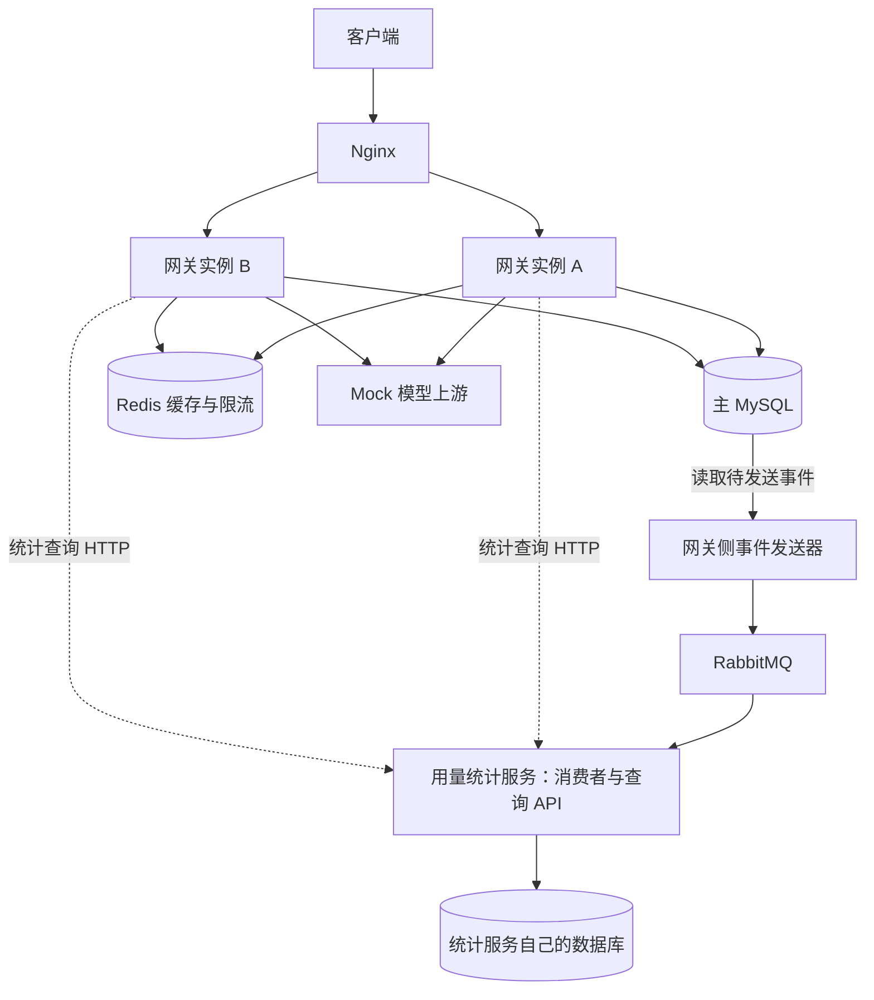

# new-api学习项目：服务端岗位能力与整体架构分析

日期：2026-09-08。状态：分析建议，尚未实施，尚未替换原来的12阶段/26课安排。

学习项目：`/Users/w/personal_study/new-api`。参考源码：`/Users/w/ruijie/new-api`。学习方式继续保持“对话给局部代码和解释，学习者在VS Code亲手输入”。本次只分析岗位要求与课程框架，不添加应用代码或安装组件。

## 1. 结论与实际进度

现有课程能练习Go服务端开发、MySQL/GORM、Redis缓存与限流、事务、部分并发问题、HTTP上游调用、日志和失败路径。但消息队列、明确的微服务边界、系统化压测、指标/调用链/告警仍有缺口，不能将原方案说成完整覆盖这些岗位要求。

建议沿同一业务逐步形成三个版本：基础单体 → 多实例与可靠性 → 消息队列和独立统计服务。日志从现在开始；数据库、上游、MQ的指标和追踪随对应功能加入。先掌握每个机制，再把它们组合成诊断闭环。

当前只读看到练习项目有main、Router、状态接口、GET问候和POST JSON绑定；上一条给出的DTO拆分和日志中间件尚未看到保存的文件。没有本轮HTTP、数据库、Redis或压测运行证据。以下“已覆盖”只指原课程的规划覆盖，不代表已实现或已掌握。

## 2. 对照岗位要求

| 岗位能力 | 原课程覆盖情况 | 扩展建议与可交付证据 |
| --- | --- | --- |
| 服务端研发 | 有主线 | 注册/登录、权限、参数校验、错误处理、配置、测试、启动退出；独立完成一个带权限和数据操作的接口 |
| 数据存储 | 有主线 | GORM与SQL对照、MySQL表/索引/事务/连接池/迁移；读EXPLAIN、复现回滚与并发更新，补备份恢复练习 |
| 缓存 | 有主线 | Cache-Aside、TTL、失效、故障回源；比较缓存命中和DB查询数，再做热点回源实验 |
| 高并发 | 有部分机制，缺容量证据 | 有限并发、超时、连接池、原子扣减、背压；补真实HTTP负载、P95/P99、资源和瓶颈分析 |
| 分布式系统 | 有部分边界 | 两个实例共享状态、重复/乱序/部分失败、幂等和补偿；复现一个实例失效、消息重复与状态恢复 |
| 微服务 | 原方案暂缓 | 后期只拆用量统计服务，明确网络契约、独立启动/部署和数据所有权 |
| 消息队列 | 原方案未纳入 | RabbitMQ生产/消费确认、重投、幂等、有限重试、死信、积压与恢复 |
| 日志和基本排障 | 有部分安排 | Request ID/trace ID、结构化日志、错误分类；按请求追踪发生位置 |
| 指标、调用链、告警 | 原方案缺完整闭环 | Prometheus/Grafana、OpenTelemetry/Jaeger、告警规则与Alertmanager；用故障演练验证识别、定位、处理和恢复 |

“良好的研发能力”用独立设计、实现、测试、诊断和解释取舍来评价；依赖清单本身不构成能力证据。课程可提供入门实践证据，不能自动等同生产规模或岗位录用判断。

## 3. 版本A：先做完整的单体业务

业务仍是精简模型网关：用户注册和登录 → 创建API Key → 配置Mock渠道 → 调用模型接口 → 预留/确认/退款教学积分 → 查看调用明细。

逻辑分层：Router负责入口与中间件范围；Controller负责HTTP输入输出；DTO描述传输数据；Service在有业务编排时加入；Model负责数据库操作；Relay负责上游HTTP。这些Go包运行在同一网关进程里。

数据边界：MySQL保存用户、API Key摘要、渠道、余额和权威调用记录；Redis先只缓存展示资料、提供原子限流。不要让资料缓存成为余额或权限的唯一判断来源。代码不必让每个简单查询都走遍所有层。

基础能力包括：context取消、HTTP超时和Body关闭、连接复用、统一错误、鉴权与资源归属、整数额度边界、短数据库事务、幂等状态、日志、表驱动与集成测试。上游HTTP在数据库事务之外；结果未知时保留pending而不盲目重复调用。

验收：自己实现一个完整受保护接口，能解释输入、状态变化、失败分支；通过HTTP响应、SQL数据和日志互相核对，而不只是接口返回200。

## 4. 版本B：同一个网关运行两个实例

部署形式为Nginx分发到网关A/B，共享主MySQL和Redis。本机可以用不同端口或容器复现网络边界。登录使用的签名密钥等必要配置要一致；重要业务状态不能只存在某个实例的内存里。

练习问题：

- 请求落到不同实例，能否读取同一用户资料、使用同一API Key？
- 两个进程各有自己的Mutex，这能否防止数据库余额跨实例被并发扣减？
- 两个实例能否共享同一个Redis限流额度，而不是分别放行一份？
- 停掉一个实例后，负载均衡何时避开它，期间有哪些请求失败？
- 上游突然变慢，在途请求、goroutine、连接池等待和超时怎样变化？
- 增加网关实例后，瓶颈是否转移到MySQL、Redis或Mock上游？

这是分布式问题的入门场景，但两个相同网关实例仍是同一种服务的副本，不能因此称为两个微服务。

高并发实践关注正确性和容量两条线：余额不能为负、请求不能重复结算；同时记录吞吐、延迟分位数、失败率、在途请求、CPU/内存、goroutine及DB连接池等待。限流控制单位时间请求数，有界并发控制同时进行的工作量，两者分开设计。

性能实验固定硬件/容器限制、数据集、Mock延迟和依赖配置，逐步增加外部请求负载。区分输入负载与实际完成吞吐，统计压测工具未能发出的请求。先建立基线，再比较单/双实例、缓存开/关、慢上游等一项变化；不预先许诺某个QPS。压测设计参考[k6开放与闭合负载模型](https://grafana.com/docs/k6/latest/using-k6/scenarios/concepts/open-vs-closed/)。

验收：保存一份带环境和工作负载说明的结果，指出一个有证据的瓶颈，进行一项修改后用同条件验证。`go test -race`保护的是所执行路径上的Go共享内存问题，不能替代SQL并发与HTTP容量实验。

## 5. 版本C：加入异步用量统计，并形成第二种业务服务

选择“调用完成后更新每日用量统计”作为异步业务。扣费和权威调用记录仍由网关主库负责；统计可以稍后更新，积压时能显示数据更新时间，而不能把过期统计当实时余额。

建议的最终业务拓扑：

主库本身不会主动发送消息，图中的发送器是读取事件表并发布消息的Go代码。发送器可以先作为网关侧唯一后台任务运行，再学习多实例领取与租约。它属于网关业务的消息发布职责，不因为独立运行就自动成为新的微服务。

消息链按下面的语义设计：

1. 网关在同一个主库事务内确认调用状态并写一条待发送事件，事务提交后再返回业务成功。
2. 发送器读取事件，发布到RabbitMQ；区分发布确认、不可路由消息、发送失败，确认符合投递约定后再标记发送状态。
3. 统计服务消费消息，在自己的数据库事务内进行event_id去重和统计更新。
4. 数据库事务提交后再确认消费；确认丢失导致重投时，去重记录防止统计被再次累加。
5. 暂时性失败有有限重试，无法处理的消息进入已配置的死信队列；暂停消费者时观察积压，恢复后核对补齐结果。

同事务保存“业务记录+待发送事件”叫Transactional Outbox，目的是处理“数据库提交了但进程还没来得及发消息就退出”的缺口；发送器仍可能重复发送，消费者必须幂等。它不让数据库和MQ变成一个跨系统原子事务。[Outbox模式说明](https://microservices.io/patterns/data/transactional-outbox.html)

RabbitMQ的生产者确认和消费者确认保护的是不同区段，生产者收到确认不代表消费者业务已经处理完成。学习时还需明确队列持久化、消息持久化、路由与重试配置，不把一次API发送成功当作端到端完成。[RabbitMQ确认机制](https://www.rabbitmq.com/docs/confirms)

微服务的教学切分：网关拥有用户、Key、渠道、余额、调用事实和Outbox；统计服务拥有统计结果和已处理事件记录，有独立入口和查询API，经HTTP/消息合同合作，不跨服务直接读写对方表。初期可在同一MySQL进程上用不同数据库和权限隔离，不能据此声称基础设施高可用。只启动一个Worker属于异步组件；形成业务边界、数据所有权、接口和独立部署后，才进入服务拆分的学习内容。[微服务架构特征](https://learn.microsoft.com/en-us/azure/architecture/guide/architecture-styles/microservices)

先选一种消息队列和一种内部通信方式；建议RabbitMQ加HTTP/JSON。业务核心不急于拆成用户、鉴权、钱包等多个远程服务。Kafka、gRPC、注册中心、Kubernetes及数据库集群留到对应学习目标出现时再加入。

## 6. 日志、指标、调用链、告警分别解决什么

| 证据 | 要回答的问题 | 练习中采集的内容 |
| --- | --- | --- |
| 日志 | 某次请求具体发生了什么？ | request_id、trace_id、实例、方法、路由、状态、错误分类与耗时；不记录凭据或完整模型输入 |
| 指标 | 问题影响多大、趋势怎样？ | 请求量/错误率/延迟分位数、在途请求、CPU/内存/goroutine、DB池等待、Redis命中率、Outbox最老事件年龄、MQ积压与重试 |
| 调用链 | 某次请求在哪个环节耗时或失败？ | HTTP Server span、数据库操作span、HTTP上游span；跨服务/消息传播上下文，关联消费者处理 |
| 告警 | 哪种异常已经持续到需要处理？ | 5xx比例、延迟、实例不可用、队列积压/最老消息年龄、Outbox长期未发送；明确窗口、阈值、持续时间和恢复条件 |

Request ID用于关联日志，不等于已经存在分布式Tracing；只有源码中的函数调用图，也不能代替运行时跨进程span。OpenTelemetry用于接入和传播遥测，链路需额外的收集/存储/展示后端，例如Jaeger。[OpenTelemetry信号说明](https://opentelemetry.io/docs/concepts/signals/)

建议先结构化stdout日志，再接Prometheus采集和Grafana展示；跨HTTP/MQ时引入OpenTelemetry与Jaeger；指标可信后增加Prometheus告警规则和Alertmanager。按路由模板聚合指标，不把user_id、request_id或完整URL作为高基数标签。CPU/goroutine持续异常时再用pprof/运行时trace等工具确认，不只看一张图下结论。[Prometheus埋点建议](https://prometheus.io/docs/practices/instrumentation/)、[Go诊断工具](https://go.dev/doc/diagnostics)

Prometheus规则负责根据指标产生告警状态；Alertmanager负责告警分组、去重和通知路由。教学先在本机验证触发和恢复，任何向他人发送告警通知的操作另按用户明确要求处理。[Prometheus告警概览](https://prometheus.io/docs/alerting/latest/overview/)

## 7. 用故障演练形成诊断能力

| 受控故障 | 观察什么 | 要说明或验证的处理 |
| --- | --- | --- |
| Mock上游变慢/返回503 | 路由P95/P99、上游span、超时/重试日志、在途数 | 区分上游慢和本地慢；超时/有界并发/有限重试；结果未知的扣费状态不能盲目重放 |
| MySQL连接池受限或测试事务持锁 | DB InUse/WaitCount/WaitDuration、查询span、锁等待 | 区分等待连接与SQL执行慢；修正长事务/查询并同条件复测，不盲目扩大连接池 |
| Redis不可用或展示缓存过期 | 连接错误、命中率、回源量、DB负载 | 展示缓存可回源，限流故障按既定策略拒绝；两条路径分别验收 |
| 一个网关实例退出 | 实例指标、负载均衡错误、请求分布 | 健康摘除/退出行为与剩余容量；不能保证故障期间零失败 |
| 消费者暂停或变慢 | MQ ready/unacked、最老未处理事件年龄、消费速率 | 区分消费能力不足与下游存储慢，恢复后查统计是否补齐 |
| 统计事务提交后消费者在确认前退出 | 同event_id重投、去重表、统计值 | 重投不重复累加，确认发生在本地事务之后 |
| 请求入口到上游调用之间传播中断 | 同请求的日志、span与父子关系 | Request ID与trace上下文正确传播，定位断点而不是只加日志数量 |

每次按“告警/现象 → 指标定位影响 → 日志和链路定位环节 → 排除其他原因 → 处理 → 同条件复测 → 复盘”走一遍。不要用睡眠或随机循环冒充性能证据；Mock受控延迟是故障输入，要把它与产品自身耗时区分。

最终提交物应包含：一张架构图、服务和数据所有权说明、可复现HTTP场景、至少一次并发不变量验证、消息重复/恢复实验、性能基线与瓶颈分析、数份故障复盘。结论限定为实际环境、实际负载和已观测证据。

## 8. 对现有课程的调整建议

1. 继续当前DTO和日志中间件小步，再完成用户/数据库/鉴权主线；同步积累日志和测试。
2. 在MySQL/Redis/Mock链路建立后，补指标、HTTP tracing、连接池和资源观察，完成单实例基线。
3. 在原有共享限流课程基础上扩大为双实例、并发额度、故障切换和受控压测单元。
4. 增加RabbitMQ、Outbox、消费幂等/恢复，再把统计形成独立服务。
5. 在已有指标和链路上加入告警与综合故障诊断，最后回读原项目与整理面试表达。

这些是待讨论的扩展方向，不是本次已经实现的内容，也不意味着课程仍能无成本维持原来的26课。具体拆成多少小步，依据实际跟敲与理解程度确定。初版基础课程作为前置保留；本机多进程实验支持学习网络边界和故障语义，不能代表生产集群的规模、可靠性或跨机器高可用验证。
